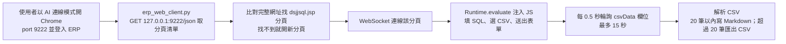

# ERP 正式機查詢方式比較：zpq 與 CDP

目前讓 AI Agent（Claude Code 等）查 ERP 資料庫有兩種方式：

- **zpq**：資訊課提供的查詢 API 用戶端，走 `zpjjQueryApi.jsp`，以個人 Token 驗證。
- **CDP**：透過 Chrome DevTools Protocol 操作使用者已登入的瀏覽器，在命令中心 `dsjjsql.jsp` 執行 SQL（`erp-prod-web-executor` 技能）。

結論先講：**正式機唯讀查詢以 zpq 為主；測試機、畫面驗證、大量明細匯出才用 CDP。**

---

## 一、運作原理

### 1. zpq


- 用戶端 `zpq.py` 只用 Python 標準函式庫（`urllib`），把 SQL 用 CP950 編碼後，以 `application/x-www-form-urlencoded` POST 到端點。
- Token 放在 HTTP 標頭 `X-API-TOKEN`，由程式自己從檔案讀取，**不會出現在命令列、輸出或錯誤訊息**。
- 端點預設 `http://erp.chsteel.com.tw/erp/zp/jsp/zpjjQueryApi.jsp`，可用環境變數 `ZPQ_URL` 或 `%USERPROFILE%/.zpq/url` 覆寫。
- **所有限制都在伺服器端執行**：只允許 SELECT／WITH、管制群組擋表、每分鐘與每日次數、回傳列數、逾時秒數。用戶端改不掉，所以適合交給 Agent。
- 輔助功能：`--tables`（找表）、`--describe`（欄位、索引、估計列數）、`--user`／`--user-name`（工號姓名對照）、`--ping`（等級與用量）。
- 結束碼：0 成功／2 查詢被拒或 SQL 錯誤／3 系統忙碌／4 Token 問題／5 設定或連線錯誤。

### 2. CDP（erp_web_client.py）



- Chrome 以 `--remote-debugging-port=9222` 啟動後，本機程式可透過 CDP 控制瀏覽器分頁。
- 腳本用 `websocket-client` 套件連上分頁，用 `Runtime.evaluate` 在頁面中執行 JavaScript：
  1. 把 SQL 填入 `SqlStr` 文字框。
  2. 輸出格式選 CSV（`Type=1`），必要時填 `RowSize`。
  3. 送出 `form1` 表單。
  4. 輪詢頁面上的 `csvData` 欄位，取回結果；`msg` 欄位出現「錯誤／Error／禁止」就視為失敗。
- **身分就是瀏覽器裡已登入的使用者**，權限和你本人在 ERP 的權限相同。
- 唯讀保護只在本機腳本：SQL 開頭不是 SELECT／WITH 就攔截。命令中心頁面本身可以執行 UPDATE／DELETE，伺服器端沒有替 Agent 另外把關。
- 以完整網址比對分頁（`erp.chsteel.com.tw/...` 或 `test.chsteel.com.tw/...`），正式機與測試機分頁同時開著也不會連錯；執行時會印出 `[主機] 正式機／測試機`。
- 結果處理：
  - 第一列是欄位標題，不計入筆數（2026-11-17 修正）。
  - 20 筆以內：寫成 Markdown 表格到 `%USERPROFILE%/query_output.txt`。
  - 超過 20 筆：匯出 CP950 CSV 到 `D:/temp/query_results/prod_query_YYYYMMDD_HHMMSS.csv`（測試機為 `test_query_…`），對話只顯示欄位與前 3 筆。

---

## 二、設定方式

### 1. zpq

**安裝（一次）**

1. 取得資訊課提供的 `zpq_setup.py`，在 Claude Code 輸入 `! python zpq_setup.py`（或直接雙擊）。需要 Python 3.8 以上（含 tkinter）。
2. 安裝程式會自動完成：
   - 安裝用戶端到 `%USERPROFILE%/.zpq/`（`zpq.py`、`zpq.cmd`，以及給 Git Bash 用的 `zpq`）。
   - 把 `%USERPROFILE%/.zpq` 加入使用者 Path。
   - 設定查詢端點（正式機／測試機）。
   - 開啟 Token 核發頁，跳出本機視窗讓你貼上 Token（**Token 不經過 AI 對話**）。
   - 測試連線並顯示 Token 等級。
   - 把查詢規則寫入 `%USERPROFILE%/.claude/CLAUDE.md`。
3. 確認：執行 `zpq --ping`，應顯示工號、到期日、等級與限制。

**相關檔案與設定**

| 項目 | 位置 |
|---|---|
| 用戶端 | `%USERPROFILE%/.zpq/zpq.py` |
| Token | `%USERPROFILE%/.zpq/token`（或環境變數 `ZPQ_TOKEN_FILE`）——**不可讀取、印出或傳遞** |
| 端點 | 環境變數 `ZPQ_URL`，或 `%USERPROFILE%/.zpq/url` 第一行 |
| 關閉展延提醒 | 環境變數 `ZPQ_NO_RENEW_PROMPT=1` |

**Token 展延**

- 到期前 5 天起，每天第一次執行 zpq 會在桌面跳出「是否展延 Token」視窗；輸出也會出現【Token 即將到期】。
- 展延：在 Token 管理頁按「展延 30 天」，Token 不變，不必重貼。
- 已到期：執行 `zpq --renew` 核發新 Token，在跳出的視窗貼上。
- 其他選項：`zpq_setup.py --reset-token`（重貼 Token）、`--uninstall`（移除）。

**目前等級（2026-11-17 `zpq --ping`）**：一般（BASIC），不可查人事、稽核群組；預設 100 列、上限 1000 列、每句 10 秒逾時、每分鐘 30 次、每日 2000 次、同時 2 句。

### 2. CDP

**前置需求（一次）**

1. Python 套件：`pip install websocket-client`（目前 1.9.0）。
2. 腳本 `%USERPROFILE%/erp_web_client.py`（已納入 chezmoi，其他電腦執行 `chezmoi update` 即可取得）。
3. 技能 `erp-prod-web-executor`（`~/.claude/skills/erp-prod-web-executor/SKILL.md`），告訴 Agent 何時與如何呼叫。

**每次使用**

1. 雙擊桌面捷徑啟動「AI 連線模式」瀏覽器：
   - `啟動正式機ERP(AI連線模式).bat`／`啟動測試機ERP(AI連線模式).bat`（Chrome）
   - `啟動正式機ERP(Edge連線模式).bat`／`啟動測試機ERP(Edge連線模式).bat`（Edge）

   捷徑內容（正式機 Chrome 版）：
   ```bat
   start "" "C:\Program Files\Google\Chrome\Application\chrome.exe" ^
     --remote-debugging-port=9222 --remote-allow-origins=* ^
     --user-data-dir="C:\ChromeERPProfile" ^
     "http://erp.chsteel.com.tw/erp/ds/jsp/dsjjsql.jsp"
   ```
   - `--remote-debugging-port=9222`：開啟 CDP 埠。
   - `--remote-allow-origins=*`：允許 WebSocket 連線。
   - `--user-data-dir`：使用獨立設定檔，不影響平常的瀏覽器，也保留 ERP 登入狀態。
2. 在該瀏覽器登入 ERP。
3. 執行查詢：
   ```powershell
   python "%USERPROFILE%\erp_web_client.py" "SELECT ..."          # 正式機
   python "%USERPROFILE%\erp_web_client.py" --test "SELECT ..."   # 測試機
   ```
4. 確認連線：`curl http://127.0.0.1:9222/json/version` 有回應即表示 CDP 埠已開。
5. Git Bash 下請先 `export PYTHONIOENCODING=utf-8`，避免主控台中文亂碼。

---

## 三、優缺點比較

| 面向    | zpq                               | CDP                                 |
| ----- | --------------------------------- | ----------------------------------- |
| 身分驗證  | 個人 Token，有到期日，可以展延                | 瀏覽器已登入的 Session                     |
| 前置條件  | 任何終端機都能直接執行                       | 要用 AI 連線模式開瀏覽器並登入，Session 過期就要重新登入  |
| 可查環境  | 只有正式機                             | 正式機和測試機（`--test`）                   |
| 唯讀保護  | 伺服器端強制；違規累計，24 小時內 3 次撤銷 Token    | 只靠本機腳本攔截；頁面本身可以執行異動                 |
| 可查範圍  | 依 Token 等級（目前不能查人事、稽核群組）          | 跟你本人在 ERP 的權限相同                     |
| 回傳筆數  | 預設 100，最多 1000                    | 沒有硬性上限；超過 20 筆自動輸出 CSV              |
| 流量限制  | 每分鐘 30 次、每日 2000 次、10 秒逾時、同時 2 句  | 依 ERP 網頁本身限制；腳本最多等 15 秒             |
| 表格資訊  | 內建 `--tables`、`--describe`、工號姓名對照 | 沒有，要自己查或靠記憶                         |
| 輸出穩定度 | 結構化 JSON，穩定                       | 要解析網頁欄位，網頁一改版就可能失效                  |
| 稽核紀錄  | 有 API 紀錄，可以知道是 Agent 查的           | 紀錄上就是你本人操作，看不出是 Agent               |
| 額外用途  | 只能查資料                             | 同一套機制可以開 ERP 畫面做唯讀驗證、填 DAJJU1 上線申請單 |

### zpq

- **優點**：適合交給 Agent 使用。防護在伺服器端，Agent 寫錯也改不到資料；可以先查欄位和索引再寫 SQL；不需要開瀏覽器，也不怕 Session 過期。
- **缺點**：只能查正式機；最多 1000 筆，10 秒逾時，大量或複雜查詢容易卡住；不能查管制群組；要管理 Token 展延；違規累計到上限，Token 會被撤銷。

### CDP

- **優點**：可以查測試機；大量結果直接輸出 CSV；跟你的 ERP 權限相同；同一套機制還能做畫面驗證。
- **缺點**：依賴瀏覽器狀態，比較不穩定；唯讀只靠本機腳本把關，風險比較高；Agent 的查詢在稽核紀錄上會算成你本人的操作。

> [!WARNING]
> 9222 埠開著、又設了 `--remote-allow-origins=*` 時，本機任何程式都能操作這個已登入 ERP 的瀏覽器。用完請關閉 AI 連線模式的瀏覽器，不要長時間開著。

---

## 四、Token 消耗比較（2026-11-17 實測）

同一句 SQL，在正式機各跑一次：

| 回傳筆數 | zpq | CDP |
|---|---|---|
| 5 筆 | 執行一次，約 **320 bytes** | 執行（134 bytes）＋讀結果檔（354 bytes），共約 **490 bytes**，而且多一次工具呼叫 |
| 50 筆 | 50 筆全部印出，約 **1,560 bytes** | 自動輸出 CSV，只顯示前 3 筆預覽，共約 **450 bytes** |

- **zpq 的消耗跟筆數成正比**：結果直接印出，格式精簡，每多一筆就多一行。
- **CDP 大約是固定成本**：20 筆以內要執行加讀檔兩次呼叫，Markdown 格式也比較長；超過 20 筆就存成 CSV，筆數越多越省。
- **zpq 有一筆前置成本**：`--describe` 輸出約 570 bytes。不過這一步可以避免猜錯欄位；實測時憑印象寫錯欄位名稱，CDP 那邊卡到 15 秒逾時才報錯，白白浪費一輪。
- **最省的做法**：把 SQL 改寫成 `COUNT`、`GROUP BY`，只取需要的彙總結果，兩種方式都只要幾十 bytes。

---

## 五、建議分工

1. **正式機唯讀查詢一律先用 zpq**：`zpq --tables` 找表 → `zpq --describe` 看欄位與索引 → 寫 SQL。
2. **以下情況改用 CDP**：
   - 查測試機資料（例如搬移資料後的比對）。
   - 結果超過 1000 筆、需要匯出 CSV 時（先想能不能改用 GROUP BY 縮小結果）。
   - 要開 ERP 畫面做唯讀驗證。
   - 使用者明確指定要用 CDP 時。
3. **被 zpq 擋下的表不改用 CDP 繞過**：例如人事、稽核群組，或逾時的查詢。先回報使用者，由使用者決定要不要請主管調整等級，或自己在畫面上查。

---

## 六、Remote Control 遠端操作範例

Claude Code 的 Remote Control 讓你用手機（Claude App）或其他電腦的瀏覽器（claude.ai/code），操作這台電腦上正在執行的 Claude Code。程式和檔案都留在本機執行，只對外連線，不會開對內的埠。

原則：**在手機上下指令、看結論，細節和檔案留在電腦上。**

### 1. 啟動與設定

| 情境 | 指令 |
|---|---|
| 目前這個對話直接開放遠端（保留對話紀錄） | 在 Claude Code 輸入 `/remote-control` 或 `/rc`，可加名稱，例如 `/rc ERP` |
| 新開一個可以遠端的互動對話 | `claude --remote-control "Obsidian"`（簡寫 `claude --rc`） |
| 伺服器模式（可同時開多個對話） | `claude remote-control`（簡寫 `claude rc`），常用參數 `--name`、`--capacity <N>`、`--permission-mode <mode>`、`--continue` |

- **連線**：打開 Claude Code 顯示的網址；或在手機 Claude App 點 **Code**，清單中有電腦圖示加綠點的就是遠端對話。伺服器模式按空白鍵會顯示 QR Code；互動對話再輸入一次 `/remote-control` 可看到狀態面板。
- **每次啟動都自動開啟**：`/config` 把 **Enable Remote Control for all sessions** 設成 `true`，或在 `~/.claude/settings.json` 加 `"remoteControlAtStartup": true`（只有使用者層級有效）。
- **推播通知**：`/config` 開啟 **Push when actions required**，Claude 等你核准時手機會跳通知。
- **停止**：互動對話在 `/remote-control` 狀態面板中斷連線；伺服器模式按 `Ctrl+C`，約四小時內可用 `claude remote-control --continue` 接回。
- **限制**：本機的 Claude Code 不能關；一個互動對話只能有一個遠端連線；伺服器模式斷網超過約 10 分鐘會結束；`/plugin`、`/resume` 等本機指令在手機上不能用。
- **前置條件（2026-11-17 已確認）**：Claude Code 2.1.326，沒有設定 `ANTHROPIC_BASE_URL`、`CLAUDE_CODE_DISABLE_NONESSENTIAL_TRAFFIC` 等會擋掉這個功能的環境變數。

> [!WARNING]
> 連線期間，對話內容（含工具執行結果）會存在 Anthropic 的伺服器上。在遠端對話中用 zpq 或 CDP 查詢，結果也會一起被存下來。ERP 查詢結果屬於公司機密，遠端時只看摘要，不要撈大量明細。

### 2. 建議的使用方式

- **上班時臨時離開座位**（開會、到現場）：在目前的對話輸入 `/rc ERP`，手機上接著做。
- **固定讓兩個專案都能遠端**：分別在 `G:/我的雲端硬碟/Obsidian` 和 `D:/CHSBrowser_erp` 開終端機，執行 `claude --rc "Obsidian"`、`claude --rc "ERP程式"`，手機上會看到兩個對話。
- **離開前**確認電腦不會進入睡眠，也不要關掉終端機。

### 3. 範例

**範例一：上線後查核准狀態（最常用）**

情境：DAJJU1 送出後要等生效，人不在座位上。

> 用 zpq 查 TBDAU1 今天我送的上線申請是否核准、預計生效時間，只回結論

> 生效了嗎？如果已生效，抽查 EAJJRE03N 那張單的 B 表 C8FE 筆數

適合原因：zpq 不需要瀏覽器，回傳摘要，手機上看得清楚。

**範例二：驗證有沒有缺口（每日觀察）**

情境：像 HGJJC01 這種要連續觀察幾天、確認缺口為 0 的案子。

> 依 HGJJC01 工作筆記裡的驗證查詢，查昨天起的派工，回報張數、人次、缺口數

> 缺口不是 0 的話，列出派工單號就好，不要列姓名

提醒：派工資料有人名，手機上只看單號和數字。

**範例三：使用者來電詢問，馬上查程式**

情境：在現場被問到某個功能怎麼運作，或某個欄位為什麼是這個值。

> 在 D:/CHSBrowser_erp 找 eajcRE00CRN 的 doCopyLatest，簡單說明新版複製的來源怎麼決定

> 用 CVS 查 eajjRE10ListN.jsp 最近三版是誰改的、改了什麼

適合原因：只讀程式、查歷史，不會改到任何東西。

**範例四：Wiki 匯入與筆記整理**

情境：通勤時，把課程素材放進 `AI/raw/`。

> 開工

> AI/raw 有新素材嗎？有的話先給我摘要重點，我確認後再匯入

> 匯入，並更新 index 和 log

適合原因：筆記在雲端硬碟，回到電腦打開 Obsidian 就看得到。

**範例五：收工**

情境：人已經離開辦公室，才想到還沒同步。

> 收工

Claude 會回報 git 和 chezmoi 的變動並提出 Commit 訊息，在手機上確認後才執行 Commit 和 Push。

### 4. 不建議在手機上做的事

| 項目 | 原因 |
|---|---|
| CDP 畫面驗證、DAJJU1 填單 | 需要電腦上的瀏覽器已用 AI 連線模式開啟並登入；人不在時 port 9222 一直開著，有安全風險 |
| 修改 ERP 程式、CVS commit | 手機上不容易看 diff，Big5 編碼出錯也不容易發現 |
| 撈大量明細 | 結果會存在 Anthropic 的伺服器上，手機上也看不清楚；改用 `COUNT`、`GROUP BY` 只取彙總數字 |
| 在手機上核准異動類工具的權限 | 畫面小容易看錯；寫入、刪除、push 這類動作回到電腦再處理 |

### 5. 小技巧

- 在手機下指令時加一句「**只回結論**」或「**三行以內**」，回覆比較好讀，也比較省 Token。
- 手機語音輸入容易出現錯字；遇到單號、工號、表名這類關鍵資料，Claude 會先確認再執行。

---

## 七、修改紀錄

- **2026-11-17**：新增第六節 Remote Control 遠端操作範例。
- **2026-11-17**：修正 `erp_web_client.py` 把 CSV 標題列算成一筆資料的問題。表頭改用實際欄位名稱，CSV 匯出也保留標題列，查無資料時正確回報 0 筆。腳本納入 chezmoi（commit `87ccc79`）。
