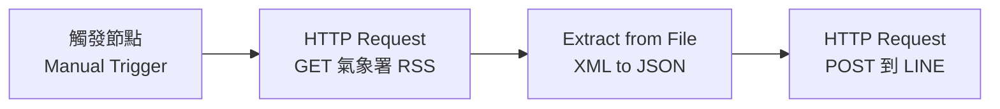
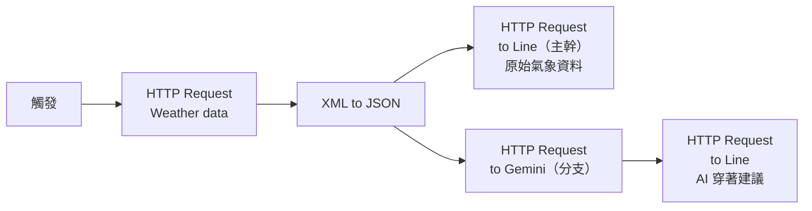

# AI 工作流程自動化實作：重點整理（第一章至第三章）

> 來源：AIUP 產發署人培專區（經濟部產業發展署）
> 課程連結：https://eii.nat.gov.tw/aimfg/course/e3eb0d6dcb2946ec88997f7f89bd57cf/detail
> 講師：李迦恩　全課長度：3 小時 13 分（Vimeo 影片三段）
> 整理依據：三段影片的 Vimeo 自動生成繁中字幕　整理日期：2026-11-12
> 說明：本課程沒有提供講義或附件下載，內容都在影片裡。簡報上的網址、JSON 範本等，講師多半沒有念出來；本文標示「（補充）」的部分是依官方文件補上的，實際內容以簡報為準。

**目錄**
- [第一章：n8n 介紹、安裝及註冊](#第一章n8n-介紹安裝及註冊)
- [第二章：無程式碼串接，專屬天氣推播小幫手](#第二章無程式碼串接專屬天氣推播小幫手)
- [第三章：結合 AI 工具（Gemini）](#第三章結合-ai-工具gemini)

---

## 課程架構（全課 3 小時 13 分）

| 章節 | 內容 | 長度 |
|---|---|---|
| **第一章（本單元）** | n8n 介紹、安裝及註冊 | 01:07:54 |
| 第二章 | 無程式碼串接：專屬天氣推播小幫手（抓氣象資料 → 推播到 LINE） | 01:01:39 |
| 第三章 | 結合 AI 工具（Gemini），依提示詞產生不同內容後推播到 LINE | 01:03:53 |

---

# 第一章：n8n 介紹、安裝及註冊

> 影片長度：01:07:54

## 一、n8n 是什麼（00:00–12:30）

### 定義
- **高度可擴充、以節點組成的工作流程自動化平台**。
- 屬於 **No-Code（無程式碼）／Low-Code（低程式碼）** 工具：
  - No-Code：不必寫程式，但仍要學怎麼操作，以及每個節點的設定知識。
  - Low-Code：只需要少量程式碼。
- **視覺化介面**：拖拉物件、拉線串接，就能組成流程。
- 可以串接各種應用程式、資料庫、API，以及 **AI 模型**。

### 整合能力
- 內建數百種服務的整合節點，例如 Google Workspace、GitHub、Slack、各種資料庫。
- 沒有現成節點的系統，可以用 **HTTP Request 節點** 或 **Webhook** 串接任何有 API 的外部資源；後續實作會用到 HTTP Request。

### 核心觀念：Node（節點）與 Workflow（工作流）
- **Node 就像積木**：**一個節點只負責一件簡單的小事**，不要讓一個節點包山包海。複雜的事就拆成多個節點。
- **Workflow 就像用積木蓋好的城堡**：節點用線串起來，資料**由左往右**流動，形成自動化流程。
- 流程有先後順序，節點不能亂擺；**先規劃好整件事要拆成哪些步驟**，再開始放節點。
- 只要每個節點的設定和邏輯都正確，整個流程會自動跑完，結果基本上會符合預期。

---

## 二、雲端版與本地版（12:30–15:30）

| 項目 | 雲端版（n8n.io 官方） | 本地版（本課程採用） |
|---|---|---|
| 費用 | 付費，錄影當時約有 20 歐、50 歐等方案 | **免費** |
| 環境 | 官方已經準備好 | 自己用 **Docker** 在桌機或筆電上建置 |
| 補充 | 也可以架在其他雲端主機上，通常比官方方案便宜，但仍要付費 | 每次使用前都要先啟動 Docker 容器 |

- 官網：https://n8n.io （上方的 Pricing 可以看價格）

---

## 三、Docker 觀念（15:30–23:00）

- **Docker** 是開源平台，用來開發、搬移和執行應用程式。
- **容器化（Container）**：把程式碼、執行環境、系統工具、系統函式庫和設定檔，打包成一個獨立的標準化單元。
- **貨櫃比喻**：
  - 標準貨櫃出現以前，鋼琴、農產品、汽車的形狀和重量都不同，搬運很麻煩又容易出錯。
  - 有了標準貨櫃之後，不管裡面裝什麼，碼頭都用同一種方式處理。
  - **Docker 就是軟體界的標準貨櫃**，解決「我的電腦能跑，搬到測試機或正式機就跑不動」的問題，例如作業系統版本不同或缺少套件。容器放到哪裡，環境都一致。
- **Image（映像檔）就像漢堡**：由很多功能層疊起來。n8n 的 image 在第一次執行時會自動下載並安裝。
- 本質上是**虛擬化**：在實體電腦裡切出一塊空間跑 Docker，再在 Docker 裡跑容器。

---

## 四、安裝 Docker Desktop（23:00–31:50）

1. 到 Docker 官網下載 **Docker Desktop**，選擇作業系統。
   - Windows 選 **AMD64**；**Intel CPU 也選 AMD64**，只有 ARM 架構的電腦才選 ARM。
2. 執行安裝檔，Configuration 畫面維持預設，直接按 **OK**。
3. 安裝完成後**關閉安裝畫面，並重新開機**（很重要）。
4. 開啟 Docker（鯨魚載貨櫃的圖示）：
   - 接受服務條款。
   - 用途選 **Personal**。
   - 可以直接用 **Google 帳號**登入註冊，再設定 username，按 **Sign up**。
   - 到信箱收 **6 位數驗證碼**，回到畫面輸入。
5. 講師建議用全新、乾淨的電腦安裝，比較不會遇到衝突；遇到問題可以問 AI 或上網搜尋。

---

## 五、用指令建立 n8n 容器（31:50–43:00）

在 Windows 搜尋 **CMD（命令提示字元）**，輸入以下指令。**所有空白與符號都要用半形**：

```bat
docker run -d -p 5678:5678 -v C:\Users\<你的使用者名稱>\<資料夾>:/home/node/.n8n docker.n8n.io/n8nio/n8n
```

| 參數 | 意義 |
|---|---|
| `-d` | 在背景執行 |
| `-p 5678:5678` | 連接埠對應（本機 5678 對應容器 5678） |
| `-v <本機路徑>:<容器路徑>` | 工作流程資料保存的位置，換電腦或重啟後資料不會遺失 |
| `docker.n8n.io/n8nio/n8n` | 要使用的 n8n 映像檔 |

> 註：字幕只念到 `-v` 後面接「C 槽使用者\自己電腦的使用者名稱」與映像檔名稱 `…io/n8n`。上面的容器路徑 `/home/node/.n8n` 和完整映像檔名稱，是依 n8n 官方文件補上的，實際寫法以簡報為準。

- **查自己的使用者名稱**：檔案總管 → 本機 → C 槽 → 使用者，資料夾名稱就是使用者名稱。**不要照抄講師的名稱。**
- **常見錯誤**：`Error response from daemon: docker-desktop is unable to start`
  - 原因是 WSL 等核心元件版本太舊。
  - 解法：先執行 `wsl --update`（兩個半形橫線，中間沒有空格），更新完後用**向上鍵**叫出剛才的 `docker run` 指令，再執行一次。
- 執行後會自動下載並安裝 image，**過程中不要關閉視窗**，等游標重新閃爍就代表完成。

### 確認容器在執行
- 開啟 Docker Desktop，左側選 **Containers**。
- 容器前面的**圓點是綠色**才代表正在執行，不是綠色就是沒有在運作。這是最重要的判斷訊號。
- Docker 內建 AI 助手 **Gordon**，可以協助排除安裝問題。

---

## 六、註冊 n8n（45:20–49:20）

1. 瀏覽器網址列輸入 **`localhost:5678`**。這裡不是 n8n 官網，是本機容器提供的頁面。
2. 填寫 email、first name、last name、password，按下一步。
3. 填問卷（客製化問題），按 **Get Started**。
4. 到信箱找 **Your license key**，每個人的 key 都不同，按 **Activate** 啟用。
5. 看到 n8n 編輯畫面，就代表環境建置完成。

---

## 七、n8n 介面導覽（49:20–57:40）

| 位置 | 功能 |
|---|---|
| **右側「＋」** | **建立節點**，最常用。會開啟數百種節點的清單，上方可以搜尋，只輸入開頭幾個字母也能找到。不必全部認識，用到什麼學什麼。 |
| **左側「＋」** | 建立 **Workflow**、建立 **Credential**（串接外部服務的授權或認證），以及資料串接。本課程只用到前兩項。 |
| 左側放大鏡 | 搜尋平台上的功能或名稱 |
| 左側展開符號 | 展開或收合功能表 |
| 首頁 **Workflows** | 列出目前所有工作流 |
| 首頁 **Credentials** | 列出已建立的驗證，例如氣象平台、LINE；一開始是空的 |
| 首頁 **Executions** | 執行紀錄，Status 會顯示 success（綠勾）或 error |

---

## 八、關機後重新啟動 n8n（57:40–01:06:30）

關機或關掉程式後，直接開 `localhost:5678` 會顯示「**無法連上這個網站**」。這是正常現象，因為 n8n 跑在 Docker 容器裡，**Docker 和容器都要在執行中**才連得上。

**重新啟動步驟：**
1. 開啟桌面的 Docker Desktop。
2. 左側選 **Containers**。
3. 容器圓點不是綠色時，按該列的 **▶（三角形）** 啟動，圓點變綠色。
4. 點容器上的 `5678` 連結，或自行在慣用瀏覽器輸入 `localhost:5678`。點連結開啟的可能不是你慣用的瀏覽器。
5. 如果還是連不上，**等大約 5 秒讓服務暖機**，再按 F5 重新整理。

**小知識**：Docker 建立容器時會**自動隨機命名**（形容詞加底線加人名），名稱跟你預期的不一樣是正常的。

---

## 本章重點速記

1. n8n 的核心就是 **Node（一個節點做一件小事）加上 Workflow（由左到右串起來的流程）**。
2. 本地版免費，但要先用 **Docker** 準備環境：`docker run -d -p 5678:5678 -v … n8n`。
3. 安裝 Docker 後要**重新開機**；Docker 無法啟動時，先執行 `wsl --update`。
4. 判斷容器是否執行：**綠色圓點**。
5. n8n 的入口是 **`localhost:5678`**，第一次要註冊並用 email 收到的 license key 啟用。
6. 每次重新使用：**開 Docker → 啟動容器 → 等 5 秒 → 開 localhost:5678**。

---

# 第二章：無程式碼串接，專屬天氣推播小幫手

> 影片長度：01:01:39（00:00–52:50 講解簡報，52:50 之後實機示範）

## 目標與構成要素

自動抓取中央氣象署的最新天氣資料，推播到自己的 LINE。過程中會輸入一些文字設定，但不需要寫程式。



做之前先記住四個要素：

| 要素 | 說明 |
|---|---|
| **Canvas（畫布）** | n8n 的設計區域 |
| **Node（節點）× 4** | 觸發、抓資料、轉格式、發送 |
| **URL × 2** | 氣象署 RSS 網址，以及 LINE 的發送網址 |
| **Token × 1** | LINE 的 Channel access token，用來識別是哪一個人的 LINE |

設計前先想好：這件大事要拆成哪幾件小事，每一件小事對應一個節點。

## 一、RSS 與資料來源（05:20–10:00）

- **RSS（Really Simple Syndication）**：一種以 XML 制定的標準資料格式。網站提供 RSS 之後，程式只要被觸發，就能**自動抓到網站最新的內容**。
- 資料來源是**交通部中央氣象署**的 RSS 服務頁面，依北部、中部、南部分區，點選縣市就能取得該縣市的 RSS 網址。課程以**高雄市**為例，網址結尾是 `.xml`。
- 氣象署不會每分鐘發布一次，抓到的是氣象署**最近一次發布**的資料。

## 二、節點 1：HTTP Request 抓取氣象資料（10:00–17:40）

1. 按畫布右上角的「＋」，搜尋 `HTTP`，點一下 **HTTP Request** 就會放進畫布。
   - 沒有專門抓氣象資料的節點，所以用通用的 HTTP Request。
   - 畫布原本是空的，加入第一個節點時，n8n 會**自動在最左邊加上觸發節點**。
2. 點兩下節點進入設定畫面。**每個節點的設定畫面都分三欄：左邊 Input、中間設定、右邊 Output。**
3. **Method** 維持預設的 `GET`，**URL** 貼上高雄市的 RSS 網址。
4. 按中間區塊右上角橘色的**執行此步驟**，右邊 Output 出現資料就代表成功。
5. 回到畫布，按下方橘色的**執行工作流程**。**每個節點右下角都出現綠色勾勾**，才代表整個流程成功。

> 原則：單一節點成功還不夠，**整條流程一起執行成功**才算數。每加一個節點就回畫布執行一次整個流程。

## 三、節點 2：Extract from File 轉換格式（17:40–27:00）

1. 按「＋」搜尋 **Extract from File**，加入畫布。
2. 設定：
   - **Mode**：`XML to JSON`
   - **Normalize Tags**：開啟（變成綠色），把 XML 標籤名稱統一轉成小寫
   - **Trim**：開啟，去掉內容開頭和結尾多餘的空白、換行等看不見的字元
   - **Explicit Root**：不開啟。開啟的話會剝掉最外層的 RSS 容器
3. 執行此步驟後，右邊 Output 會比原本的 XML 整齊很多。

### JSON 是什麼
- **輕量的資料交換格式**，讓不同電腦、不同程式語言能用同一種格式傳資料。
- XML 的標籤又多又長；JSON 省掉繁雜的標籤，**檔案比較小，傳輸比較快**。
- 核心是**鍵值對（key-value）**：鍵就像資料庫的欄位名稱，值就是欄位內容。例如 `"姓名": "王小明"`。
- 一個鍵也可以對應多個值，例如「專長技能」有三項，所以 JSON 又稱為**半結構化**資料。

## 四、節點 3：HTTP Request 發送到 LINE（27:00–36:10）

> **LINE Notify 已經停止服務。** n8n 裡雖然還找得到 LINE Notify 節點，但已經不能用，要改用 **LINE Bot（Messaging API）**。n8n 沒有現成的 LINE Bot 節點，所以一樣用 HTTP Request。

| 設定項目 | 值 |
|---|---|
| Method | **POST** |
| URL | `https://api.line.me/v2/bot/message/broadcast`（全部半形，注意數字 0 和英文字母 O） |
| Send Headers | 開啟，選 **Using Fields Below** |
| Header 1 | Name：`Authorization`；Value：`Bearer <你的 LINE token>`（Bearer 的 B 大寫，後面空一格） |
| Header 2 | Name：`Content-Type`；Value：`application/json` |
| Send Body | 開啟；Body Content Type 選 **JSON**；Specify Body 選 **Using JSON** |
| JSON | 切換成 **Expression**，從左邊 Input 把要顯示的欄位（例如 `title`）**拖拉**到訊息文字裡 |

### GET 與 POST 的差別
- **GET**：要「拿東西」時用，例如取得、查詢、下載、列出。
- **POST**：要「送東西」時用，例如發送、提交、廣播、上傳。
- 所以向氣象署取資料用 GET，推送到 LINE 用 POST。

### LINE 訊息 JSON 範本（補充）
講師的 JSON 在簡報上，影片沒有念出來。LINE broadcast API 的基本格式如下，`{{ }}` 裡面的內容用拖拉的方式產生：

```json
{
  "messages": [
    { "type": "text", "text": "{{ $json.rss.channel.item.title }}" }
  ]
}
```

> 實際的欄位路徑要看你左邊 Input 的資料結構。用拖拉的方式最不容易出錯，右邊 Result 會即時顯示結果。

## 五、取得 LINE Channel access token（36:10–48:20）

1. 進入 **LINE Developers Console**（補充：`https://developers.line.biz/console/`），用帳號密碼或 QR Code 登入。
2. 在 **Providers** 旁邊按 **Create**，輸入 Provider 名稱（講師用 `Weather Notify`，名稱可以自訂），再按 Create。
3. 點選 **Create a Messaging API channel**，再點 **Create a LINE Official Account**。
4. 填寫官方帳號資料：帳號名稱、**自己的 email**、所在地區、業種等，按確定，再按完成。
5. 完成後 LINE 會多一個好友（例如 Weather Notify），並傳來「感謝加入好友」。**這時只是建好 LINE 官方帳號，還沒有跟 n8n 串起來。**
6. 申請認證帳號：一路按同意、下一步。
7. 在 LINE Official Account Manager 按右上角的**設定**，進入**帳號設定**，其他設定維持預設。
8. 左邊選 **Messaging API**，按 **啟用 Messaging API**，選擇剛才建立的 Provider，按同意。隱私權政策可以不填，按確定，再確認一次。
9. 回到 Developers Console，點進 Bot 的 channel，切到 **Messaging API** 分頁，捲到最下面的 **Channel access token**，按 **Issue** 產生 token。
10. **複製這串 token**（很長），貼到 n8n 的 Authorization：`Bearer <token>`。**每個人的 token 都不一樣，也不要外流。**

## 六、執行結果與實機示範（48:20–01:01:39）

- 執行整個工作流程後，LINE 的 Weather Bot 會收到「高雄市今日天氣、溫度、降雨機率」的訊息。
- 早上 9 點執行卻拿到早上 5 點的資料是正常的，因為抓到的是氣象署最近一次發布的資料。
- 實機示範的技巧：
  - Docker 容器剛啟動時，`localhost:5678` 可能暫時連不上，等一下再重新整理。
  - 畫布左下角的放大鏡可以縮放畫面；用觸控板可以拖動畫布。

## 第二章重點速記

1. 流程是：**觸發 → GET RSS → XML 轉 JSON → POST 到 LINE**。
2. 沒有現成節點時就用 **HTTP Request**，這是通用節點。
3. **取資料用 GET，送資料用 POST。**
4. LINE Notify 已停止服務，要改用 **LINE Messaging API 的 broadcast**，並在 Header 加 `Authorization: Bearer <token>`。
5. 每個節點先執行單一步驟，再回畫布執行整個流程，**每個節點都出現綠色勾勾**才算成功。

---

# 第三章：結合 AI 工具（Gemini）

> 影片長度：01:03:53（00:00–38:45 講解簡報，38:45 之後實機示範）

## 目標

延續第二章的流程，在 **XML 轉 JSON 之後拉出一條分支**：把氣象資料交給 **Gemini**，請它建議當天的穿著和要準備的東西，再推播到 LINE。



- **為什麼 LINE 會收到兩則訊息？** 這是講師刻意設計的**驗證機制**。主幹傳原始氣象資料，分支傳 AI 的建議，兩者互相對照，確認 AI 沒有亂講。等到完全信任 AI 之後，就可以拿掉這個檢查。

## 一、新的操作技巧（04:00–15:20）

| 操作 | 方法 | 用途 |
|---|---|---|
| **複製工作流** | Workflows 清單 → 工作流右邊的「⋯」→ **Duplicate** | 用副本修改，原本的流程不會被改壞，例如 `My workflow 7 copy` |
| **連線** | 拖曳節點右邊的小白點，拉到下一個節點 | **沒有連線，資料就不會傳下去**；同一個節點可以拉出多條分支 |
| **複製節點** | 點選節點，上方出現 ▶、電源、垃圾桶、「⋯」，按「⋯」→ **Duplicate** | 要用的節點畫面上已經有時，不必再搜尋新增 |
| **重新命名節點** | 「⋯」→ **Rename** | 幫助日後記得每個節點在做什麼，例如 `HTTP Request (to Gemini)`、`HTTP Request (to Line)`、`Weather data`。名稱可以自訂 |
| **停止容器** | Docker Desktop → Containers → Actions 的 **Stop** | 電腦資源吃緊時先暫停。容器還在，之後按 ▶ 就能重新啟動。**不要按垃圾桶，按了會刪掉容器，整個環境要重做** |

## 二、取得 Gemini API Key（18:00–23:40）

- **API 就像餐廳服務生**：把你的點單（需求）用廚房（服務）看得懂的格式送過去，再把做好的餐點端回來。
- 步驟：
  1. 進入 **Google AI Studio**（補充：`https://aistudio.google.com/apikey`），登入 Google 帳號。
  2. 按右上角 **Create API key**。
  3. 選 **Create project**，輸入專案名稱（講師用 `Gemini Project`），再按 Create project。
  4. 在左邊的 **Projects** 確認專案已經建立，點進去按 **Create key**。
  5. 複製 **API key**。忘記的話可以從左邊的 **API keys** 再查到。
- 取得 Gemini API key 的流程比申請 LINE token 簡單很多。

## 三、在 n8n 建立 Credential（23:40–26:10）

1. n8n 首頁 → **Credentials** → 右上角 **Create credential**。
2. 選擇 **Header Auth**，按 Continue。
3. **Name** 填 Header 名稱，**Value** 貼上 Google API key，按 **Save**。
   - （補充）Gemini API 用 API key 驗證時，Header 名稱是 `x-goog-api-key`，講師在影片中沒有念出來。
4. 建好的 Credential 之後在節點裡會顯示為 `Header Auth account`。

> Credentials 除了這個，也可以串 Google Drive、Google Sheets、Gmail，或需要會員才能取得的氣象資料網站。

## 四、節點：HTTP Request (to Gemini)（15:20–30:30）

| 設定項目 | 值 |
|---|---|
| Method | **POST**（要把資料送給 Gemini） |
| URL | Gemini API 的網址，**全部小寫**，課程用 **Gemini 2.5**。（補充）格式為 `https://generativelanguage.googleapis.com/v1beta/models/gemini-2.5-flash:generateContent`，型號以簡報為準 |
| Authentication | **Generic Credential Type** → **Header Auth** → 選 `Header Auth account` |
| Send Headers | 開啟，選 Using Fields Below；Name：`Content-Type`，Value：`application/json` |
| Send Body | Body Content Type 選 **JSON**；Specify Body 選 **Using JSON** |
| JSON | 選 **Expression**，寫入提示詞，並把氣象欄位**拖拉**進去 |

### 講師的提示詞（依字幕還原）

> 你是一位氣象主播，不用問安。請先告訴我今日真實的天氣狀況，再用不超過 40 字的中文，建議我今天的穿著與注意事項，內容要適合在 LINE 上推播。

提示詞的設計重點：
- **指定角色**：氣象主播。
- **去掉客套話**：不要早安、午安，也不要心靈雞湯。
- **先複述原始資料**：避免 AI 用「今天天氣涼爽，穿短袖就好」這類萬用句應付，同時可以驗證它讀到的是最新資料。
- **限制字數與用途**：40 字以內，適合 LINE 推播。

### Gemini 請求 JSON 範本（補充）

```json
{
  "contents": [{
    "parts": [{
      "text": "你是一位氣象主播……（提示詞）\n氣象資料：{{ $json.rss.channel.item.description }}"
    }]
  }]
}
```

## 五、節點：HTTP Request (to Line)（30:30–36:40）

- 設定和第二章的 to Line 節點**完全相同**：POST、`https://api.line.me/v2/bot/message/broadcast`、`Authorization: Bearer <LINE token>`、`Content-Type: application/json`、Send Body 用 JSON。
- **分支上的節點不知道主幹節點的設定。** 複製過來的節點如果缺少 URL 或 token，要自己補上。忘記 token 時，可以到主幹節點裡查，或回 LINE Developers Console 再看一次。
- JSON 改為**拖拉 Gemini 回傳的文字欄位**。不需要的內容選起來刪掉，右邊 Result 可以即時確認。
  - （補充）Gemini 回傳的文字通常在 `candidates[0].content.parts[0].text`。

## 六、執行結果與補充（36:40–01:03:53）

- 執行整個工作流程時，**分支也會自動執行**。Gemini 節點要讀資料、生成內容，會停比較久。
- LINE 收到的範例：
  - **AI 分支**：「高雄市今日白天陰時多雲，氣溫 31～33 度，降雨機率 20%」，後面接穿著與準備建議。
  - **主幹**：原始氣象資料。兩則對照之後，確認 AI 沒有亂講。
- **擴充方向**：
  - 可以拉更多分支。
  - 可以用 **IF**、**Switch** 節點做條件判斷，例如二選一或多選一。
  - 可以讀寫各種資料。
  - 觸發節點可以改成**定時執行**，例如每天固定時間推播。
- **網路需求**：只啟動 Docker 容器不需要網路；但流程要串接 LINE、Gemini 等外部服務時，**網路必須暢通**。
- 講師的提醒：**資料是 AI 的底氣**。AI 好還不夠，資料來源也要好。

## 第三章重點速記

1. 先 **Duplicate** 原本的工作流，再修改副本。
2. 從 XML 轉 JSON 節點**拉出分支**，依序串 to Gemini 和 to Line。
3. 到 Google AI Studio 申請 **API key**，在 n8n 建立 **Header Auth** credential。
4. to Gemini 節點：POST、Gemini 2.5 的 URL、Header Auth、JSON Expression 加上提示詞。
5. 提示詞的寫法：**指定角色、要求先複述原始資料、限制字數、指定用途**。
6. 用主幹和分支**兩則訊息互相對照**，驗證 AI 的輸出。

---

## 對 ERP 工作的參考（整理者補充，非課程內容）

- 可以借用的模式：「排程觸發 → 抓資料（API 或 DB）→ AI 摘要 → 推播通知」，適合用在每日異常報表、待辦提醒、交期或庫存警示。
- n8n 用 Docker 自架，資料可以留在公司內網，比 SaaS 型工具好管控；但把資料送到 Gemini 等外部 AI 之前，要先確認資料機密與個資規範。
