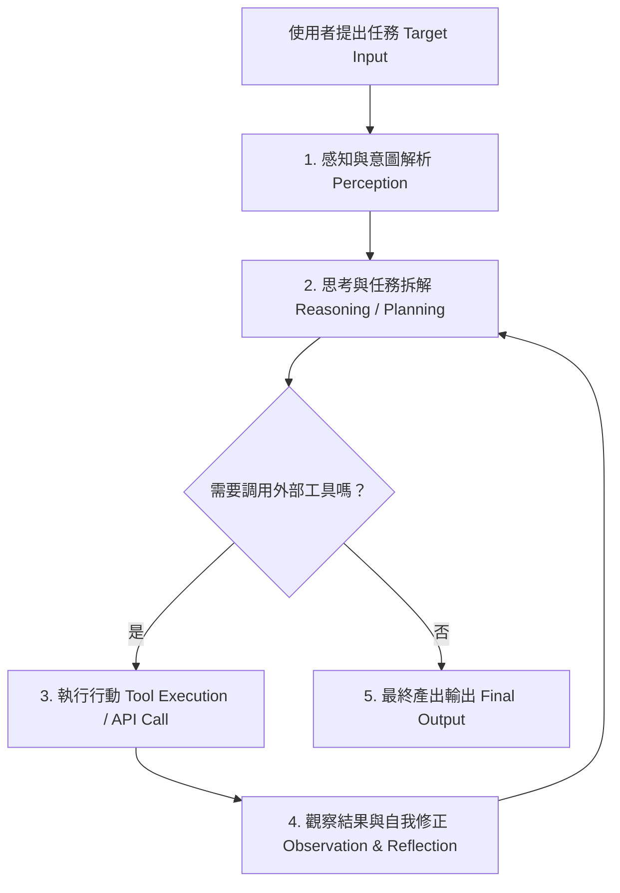

# AI Agent (Agent Bot) 企業級架構與實務應用指南

## 1. 什麼是 AI Agent (Agent Bot)？

**AI Agent（智慧代理機器人 / Agent Bot）** 是一種結合大型語言模型（LLM）大腦與自動化執行能力的進階 AI 系統。

與傳統僅能依據文字輸入進行單向回覆的聊天機器人（Chatbot）不同，Agent Bot 具備**自主思考、目標導向、任務規劃與工具調用**的能力。它能夠將複雜的目標拆解成多個步驟，並透過 API、資料庫、網頁搜尋或程式碼執行來完成任務。

---

## 2. 核心運作原理（Architecture & Mechanics）

Agent Bot 的運作核心通常基於 **ReAct 架構（Reason + Act，推理與行動）**。這是一個動態的閉環循環系統：



### 核心組件說明

1. **規劃與推理 (Planning & Reasoning)**：
   * **Task Decomposition**：將複雜目標拆解為可執行的次要任務（Sub-goals）。
   * **Reflection & Self-Correction**：在執行出錯（例如 API 回傳 404 或語法錯誤）時，能夠分析錯誤訊息並自我調整重新嘗試。
2. **記憶機制 (Memory Systems)**：
   * **Short-Term Memory**：利用 Prompt / Context Window 紀錄當前對話歷史與中間執行結果。
   * **Long-Term Memory**：透過向量資料庫（Vector DB）或外部儲存，長期儲存使用者偏好與跨階段上下文。
3. **工具調用 (Tool Use / Function Calling)**：
   * 允許 LLM 決定在什麼時候呼叫何種 API、執行 Python 程式碼、查詢 SQL 資料庫或執行網頁爬蟲。

---

## 3. 部署與啟動環境 (Deployment Environments)

Agent Bot 可根據業務需求與資安等級，部署在以下不同環境中：

| 部署環境 | 適用技術與工具 | 典型應用場景 |
| :--- | :--- | :--- |
| **本地開發與邊緣端 (Local)** | Local LLM (Ollama, vLLM), Claude Code CLI, FastMCP, Python/Node.js 環境 | 本地程式碼撰寫、私有文件處理、個資高度敏感運算。 |
| **雲端與容器化 (Cloud & Docker)** | Docker, Kubernetes, AWS Lambda/ECS, GCP Cloud Run | 24/7 不間斷服務的企業客服、批次作業排程（Cron Job）、系統自動維運。 |
| **用戶端與通訊軟體 (Client App)** | LINE Bot, Slack Apps, Microsoft Teams, Streamlit, Web Frontend | 企業員工內部助手、客戶服務介面、跨部門協作機器人。 |

---

## 4. 企業與特定系統中的四大核心應用場景

```
 ┌─────────────────────────────────────────────────────────┐
 │                   Enterprise Systems                    │
 │  ERP / CRM / HR / MES / Database / API / Search Index   │
 └───────────────────────────┬─────────────────────────────┘
                             │
            ┌────────────────┴────────────────┐
            │   Enterprise AI Agent Engine   │
            │   (LLM + ReAct + Action Tools)  │
            └────────────────┬────────────────┘
                             │
     ┌───────────────────────┼───────────────────────┐
     ▼                       ▼                       ▼
【IT 維運與知識庫】       【業務與 ERP 自動化】    【製造與資安監控】
```

### 1. 內部企業知識庫與 RAG 智能檢索（RAG Knowledge Agent）
* **場景**：企業內部龐大的 SOP、規格書、歷年維修紀錄檢索困境。
* **Agent 運作**：
  * 當員工提問時，Agent 不僅從向量資料庫（FAISS, Chroma, Pinecone）撈取相關文字，更能**主動調用系統 API** 查詢線上記錄進行交叉比對。
  * **實例**：工程師詢問設備報錯，Agent 自動調閱歷史維修單、核對當前零件庫存，並直接擬定維修建議書與備品請購單。

### 2. ERP / CRM 跨系統流程自動化（Workflow Automation Agent）
* **場景**：跨部門間繁瑣的非標準格式資料處理（PDF、Email、估價單）。
* **Agent 運作**：
  * **非結構化資料解析**：自動讀取並結構化 PDF 發票/估價單，調用 ERP API 完成建檔。
  * **定時排程批次處理 (Batch Automation)**：配合排程架構（如 Quartz/Airflow），深夜自主執行財務資料核對，發現數據異常時自動建立調查事件並通報主管。

### 3. 工廠製造與供應鏈決策（Smart Manufacturing & Supply Chain Agent）
* **場景**：製造業 MES（製造執行系統）排程與設備突發狀況應變。
* **Agent 運作**：
  * **動態產能調度**：生產線故障時，Agent 接收 IoT 警報，主動查詢 MES 備用產能，計算對交期的影響並提供最佳排程變更方案。
  * **供應鏈預警**：自動追蹤原料到貨狀況，當預估存量低於安全水位時，自主擬定採購清單。

### 4. 資安稽核與設備監控（Cybersecurity & Audit Agent）
* **場景**：定期系統權限盤點與資安事件（ISO 27001）日誌稽核。
* **Agent 運作**：
  * **主動自動掃描**：呼叫背景腳本探測網段與伺服器埠口狀況。
  * **異常行為處置**：發現離職帳號異常登入或深夜大量資料存取時，Agent 自動分類事件等級、封鎖臨時權限，並產出事件報告送交資安主管。

---

## 5. 補充：主流技術生態與開發框架 (Ecosystem & Frameworks)

若要開發企業級 Agent，目前業界常用的開發工具與標準包含：

1. **框架與庫 (Frameworks)**：
   * **LangChain / LangGraph**：適合構建複雜且具備狀態控制（State Machine）的循環 Agent。
   * **CrewAI**：專注於「多代理人協作（Multi-Agent System）」，讓不同的 Agent 分別扮演經理、工程師、文案等角色。
   * **AutoGen (Microsoft)**：強大的多代理對話與自動化寫程式框架。
2. **標準化接口 (Protocol)**：
   * **MCP (Model Context Protocol)**：由 Anthropic 提出的開源標準，讓大模型能以統一的安全協議連接各種本地/雲端資料源與工具 API。

---

## 6. 補充：企業導入 Agent Bot 的關鍵挑戰與對策

在企業環境中導入 Agent Bot 時，需特別注意以下四個核心構件：

| 挑戰領域 | 問題描述 | 企業級解決方案 |
| :--- | :--- | :--- |
| **資料安全與權限** | Agent 可能過度存取敏感資料或執行非法命令。 | **RBAC 權限控管**：Agent 執行任何 API 操作時必須帶入當前使用者的權限代碼（Token），禁止全域最高權限（Root/Admin）。 |
| **不可預測性與確定性** | LLM 偶有幻覺（Hallucination）或不依規定執行。 | **Human-in-the-Loop (HITL)**：涉及高風險操作（例如高額轉帳、刪除 DB、寄出對外信件），Agent 僅能提議，必須經由人工點擊確認後才執行。 |
| **上下文與成本** | 多輪 ReAct 思考會快速消耗 Token 並增加延遲。 | **Prompt & Context Optimization**：建立快取機制（Prompt Caching）、摘要機制與控制 maximum step 限制。 |
| **系統可觀測性** | 難以追蹤 Agent 的思考過程與除錯。 | **Agent Tracing**：引入 LangSmith、Phoenix 或 OpenTelemetry 等追蹤工具，完整記錄 Agent 的每一步 Thought、Action 與 Response。 |

---
*文件編制版本：1.0 | 適用於企業 AI 自動化架構規劃*