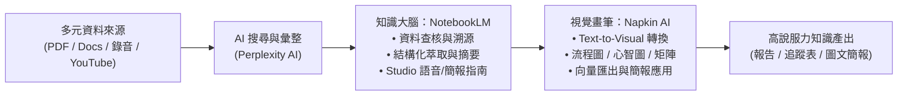
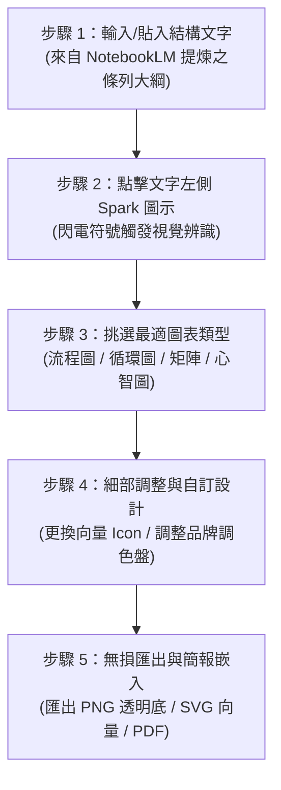

# 【搞懂 NotebookLM 與 Napkin AI - 提升你的知識管理力】完整重點與操作全攻略

> 課程平臺：[臺南市政府 e 學補給站（e 等公務園+學習平臺）](https://etainan.elearn.hrd.gov.tw/learn/)  
> 授課講座：巨匠電腦 蘇世榮 專任講師  
> 課程時長：共 6 個核心章節（總時長約 172 分鐘）  
> 學習目標：掌握 Google 專屬知識庫工具「NotebookLM」與文字視覺化神器「Napkin AI」，打通「資料收集 → 知識萃取 → 結構整理 → 視覺呈現」的完整知識管理閉環。

---

## 壹、核心概念：雙 AI 協同知識管理工作流

傳統知識管理最大的痛點在於：**資料分散難以消化、整理耗時費力、輸出成果欠缺視覺溝通力**。  
本課程透過 **NotebookLM + Napkin AI** 建立兩段式強效協同流程：



1. **NotebookLM（知識大腦）**：以使用者提供的資料為「唯一依據（Grounding）」，徹底解決大型語言模型的幻覺問題，負責閱讀龐雜資料、跨文件比對、提煉結構化文字與決策洞察。
2. **Napkin AI（視覺畫筆）**：將 NotebookLM 萃取出的文字重點與大綱，一鍵轉換為符合人類視覺閱讀習慣的高品質資訊圖表、心智圖、流程圖與矩陣圖。

---

## 貳、章節詳細重點與操作方式解析

### 第一單元、「NotebookLM」介面操作與使用重點解析（時長：41 分 36 秒）

#### 1. 介面三大核心版面架構
* **左側「來源面板（Sources）」**：
  * 用於管理與勾選資料來源，使用者可針對特定任務自由勾選「全部來源」或「單一/部分來源」。
  * 單一筆記本（Notebook）上限支援 **50 個來源**，每個來源單檔上限 **200 MB**，文字字數上限約 **50 萬字**。
* **中間「對話與檢索區（Chat / Query）」**：
  * 向知識庫提問的互動對話框。
  * 每條回覆均強制附帶 **引用來源標號（Citations）**，點擊標號會直接跳轉並高亮顯示原始文件的對應段落，方便快速查核校對。
* **右側「工作室與記事本（Studio / Notes）」**：
  * 提供「語音摘要（Audio Overview）」、「常見問題集（FAQ）」、「學習指南（Study Guide）」、「時間軸（Timeline）」、「簡報大綱（Briefing Doc）」等自動化產物。
  * 支援將 AI 對話結果「轉換為筆記（Save to note）」獨立儲存，並可作為後續合成與自訂文章的新材料。

#### 2. 各類資料來源的支援規格與重要限制
* **Google 雲端原生檔案**：支援 Google 文件（Docs）與 Google 簡報（Slides）。
* **本機上傳文件**：支援 PDF、純文字檔（.txt）、Markdown（.md）。
* **網頁連結（Web URLs）**：
  * **限制**：僅能擷取公開網頁的純文字內容；無法讀取需要登入或具備付費牆的頁面；無法辨識網頁內的圖片文字或嵌入式外部播放器影片。
* **YouTube 影片連結**：
  * **限制**：**必須具備字幕軌（CC 字幕或自動字幕）**，無字幕影片無法分析；不支援私人影片；72 小時內新發布的影片，若後台字幕尚未索引完成，可能暫時無法匯入；單一影片文字上限同樣為 50 萬字。
* **語音/音訊檔案（Audio）**：支援 MP3 等會議或訪談錄音，系統會自動在後台進行語音轉文字並建立索引。

#### 3. 搭配 AI 搜尋引擎（Perplexity AI）快速築底
* 若本身缺乏基礎文件，可先使用 AI 搜尋引擎（如 [Perplexity AI](https://www.perplexity.ai/)）進行廣度探索。
* **實用提示詞**：`幫我找出"ESG"的相關資料，包含網頁、文件檔、影片`。
* 將搜尋到的法規規範、權威研報網址與公開影片，批次匯入 NotebookLM 打造專題知識庫。

---

### 第二單元、「NotebookLM」筆記本實作與應用練習（時長：21 分 08 秒）

#### 1. 會議錄音檔全自動整理術
傳統聽打會議錄音需耗費數倍時間，透過上傳會議音訊（如課程示範之公務委員會會前會錄音），可透過階梯式提示詞精準萃取資訊：

* **操作步驟 1：產出精準文字摘要（500 字）**
  * 提示詞：`幫我完成會議記錄重點摘要，500 字。`
* **操作步驟 2：三段式結構洞察提煉**
  * 提示詞：
    ```text
    請依照以下三段式結構梳理：
    1. 背景議題：這段討論是在處理什麼核心主軸？
    2. 重點觀察：過程中出現哪些關鍵數據、爭議或決策？
    3. 行動建議：這段話最後導出了什麼事要做？有責任人與時限嗎？
    ```
* **操作步驟 3：任務責任矩陣清單化（What / Who / When）**
  * 提示詞：`請根據來源資料，列出所有可辨識的任務，標示 What（要完成什麼事？）／Who（誰負責？）／When（什麼時候要完成？），若有待確認的資訊請註記。`
* **操作步驟 4：一鍵生成專業會後追蹤 Email**
  * 提示詞：
    ```text
    根據來源資料生成會後追蹤 Email。請嚴格依流程輸出：
    1. 會議摘要（三段式：背景議題／重點觀察／行動建議）
    2. 任務清單（What／Who／When）
    3. Email 草稿（以專業、精簡語氣撰寫，結尾請列出下一個檢視節點）。請在內容中善用條列，確保收件者一眼就能掌握重點。
    ```

#### 2. 資料來源可靠性評級：ABCD 打分法
面臨海量資訊時，講師提出了一套判斷來源質量的標準化演算法：

| 評級 | 可靠程度 | 時間維度 | 內容類型 | 來源權威性 |
| :---: | :---: | :---: | :---: | :--- |
| **A 級** | 高度可靠 | 近 6 個月內 | 具體數據、法規明文 | 官方機構、主要研究機構、業界權威報告 |
| **B 級** | 可靠 | 6～18 個月內 | 具體數據或高階見解 | 知名媒體、具備業界實績之專家作者 |
| **C 級** | 一般 | 18～36 個月前 | 見解與觀點為主 | 個人部落格、二手整理、非權威觀點 |
| **D 級** | 可信度低 | 3 年以上 | 主觀判斷、情緒化內容 | 來源不明、缺乏專業背書或無數據佐證 |

* **判斷準則**：先檢查「時間」，再檢視「類型」，最後檢驗「來源」，迅速標註 A / B / C / D。

---

### 第三單元、「NotebookLM」工作室功能應用練習（時長：28 分 35 秒）

#### 1. 雙人對話語音摘要（Audio Overview / Deep Dive）客製化
* NotebookLM 內建將文件轉為生動、自然的雙主持英語 Podcast（支援部分多國語言試驗功能）。
* **自訂導向提示詞（Customize Prompt）**：
  若希望語音對話不流於表面寒暄，可點擊「自訂（Customize）」並輸入導引指引。
  * 範例提示詞：`辯論重點在於如何了解 "ESG 報告框架與標準指南"，語氣專業，要讓一般民眾聽得懂。`
  * 如此主持人間會針對專有名詞進行比喻化解說，並聚焦在核心議題辯證上。

#### 2. 自動產出研習工具鏈
* **常見問題（FAQ）**：自動預測利害關係人最常問的 5～10 個核心問題並附上答案。
* **學習指南（Study Guide）**：產出課程綱要、短答題與申論複習題，適合用於公務教育訓練或考核。
* **時間軸（Timeline）**：適用於法規修訂歷程、專案推動進度或歷史沿革整理。

#### 3. 自訂指南與心智圖架構化（Custom Guide）
* 針對特定專題（如 ESG 永續報告），可主動設定分析維度，要求 AI 依據指定骨幹重整所有來源。
* **實作範例指令**：
  ```text
  建立一份以 ESG 為主題的專業報告內容架構，設定為：
  『環境策略（E）、社會責任（S）、公司治理（G）、執行流程與指標、績效衡量與揭露、法規與永續發展趨勢』，
  並著重在企業永續經營與 ESG 實務推動的說明。
  請以一般民眾能看懂的語氣撰寫，避免過多艱澀專有名詞。
  ```

---

### 第四單元、「NotebookLM」簡報與資訊圖表功能應用及編修（時長：22 分 39 秒）

#### 1. 簡報設計四大核心守則
利用 NotebookLM 生成投影片大綱或投影片草稿時，必須嚴格遵守以下視覺溝通法則：
1. **單頁單一概念（One Idea per Slide）**：每頁投影片只傳達一個核心訊息，避免將所有內容塞進同一頁。
2. **25% 充足留白**：版面保留 25% 左右的空白空間，降低認知負荷與視覺壓迫感。
3. **資訊層級分明**：主要數據與重點結論加大突顯，次要說明以色塊模組或視覺引導線區隔。
4. **數據與觀點視覺化**：避免純文字條列，將對比、流程或比例轉化為結構化圖形。

#### 2. 簡報提示詞模板
```text
【基本資訊】
- 主題：ESG 報告框架與標準指南
- 內容大綱：環境策略（E）、社會責任（S）、公司治理（G）、執行流程與指標、績效衡量與揭露、法規與永續發展趨勢
- 目標對象：公司主管 / 決策團隊

【設計風格】
- 保留 25% 左右的留白空間，避免視覺擁擠
- 資訊層級分明，主要數據突出展示
- 所有文字清晰易讀，圖標與文字比例協調
- 使用視覺引導線或色塊區分不同資訊模組

【輸出要求】
- 每頁一個核心概念，一眼就讓讀者看懂你想表達什麼
- 數據盡量視覺化呈現，層次分明
```

---

### 第五單元、吉祥物製作應用與「NotebookLM」工作表功能應用練習（時長：35 分 41 秒）

#### 1. 結構化表格萃取與敏捷監控表
* **問卷與需求表格化**：
  從非結構化表單中，要求 AI 僅產出關鍵欄位。
  * 範例指令：`請將這份學習需求整理成一份表格，表格只要：想學技能、希望得到的幫助、需求人數、解決的急迫性，這四個欄位。`
* **專案/會議風險燈號追蹤表（Risk & Action Tracker）**：
  * 欄位規範：
    1. 日期（YYYY/MM/DD）
    2. 議題分類
    3. 狀態燈號：🟢 綠燈（順利/已解決）、🟡 黃燈（潛在風險/需觀察）、🔴 紅燈（嚴重延誤/重大卡關）
    4. 關鍵決策
    5. 風險與卡點
    6. 關鍵數據（精準提及百分比、金額或數量）
    7. 下一步與期限（格式：事項 by MM/DD）
    8. 負責人

#### 2. 品牌一致性與吉祥物角色融入提示詞
為使內部宣導或簡報具備品牌個性與親和力，可設定專屬角色（如課程中的代言吉祥物「茂矽」）：

```text
資訊圖表生成指令（品牌一致性版）

【品牌角色要求】
請在整張資訊圖表中持續使用我上傳的品牌代言人「茂矽」，並確保：
- 角色顏色與來源圖片完全一致
- 角色風格與整體畫面高度融合，不突兀

【資訊圖類型與主題】
- 類型：觀點型資訊圖
- 主題：要如何學習呢？內容基於已上傳的學習需求整理表進行歸納，不憑空捏造

【風格與配色】
- 視覺風格：手繪塗鴉風格
- 配色方向：溫暖、專業的學習風格色調，避免過於花俏

【版式與角色動態運用】
- 請讓代言角色自然出現在 5～7 個關鍵觀點旁邊
- 每一個觀點中，角色動作需具備語意關聯：
  * 指著問題進行重點說明
  * 抱著書本象徵深度學習
  * 對關鍵提醒露出驚訝或提示表情
- 角色必須與該觀點內涵高度綁定，而非純粹當作多餘裝飾
```

---

### 第六單元、「Napkin」介面操作與練習（時長：22 分 25 秒）

#### 1. Napkin AI 工具定位與操作優勢
* 官方網址：`https://app.napkin.ai/`
* **定位**：革命性的「文字即時轉視覺圖表（Text-to-Visual）」線上工具。
* **痛點解方**：免去繁瑣的拉框、對齊、排版步驟；只要貼入一段有結構的文字，Napkin 會在數秒內自動推薦多種圖解方案。

#### 2. Napkin 核心操作 5 步驟


1. **步驟 1【貼入文字】**：將 NotebookLM 產出的重點文字（如 ESG 策略、關稅因應措施或人口統計數據）貼入 Napkin 文件中。
2. **步驟 2【點擊 Spark 閃電按鈕】**：游標移動到段落旁，會出現藍色閃電 Spark 按鈕，點擊後系統會立即分析文意並生成多個視覺化圖表預覽。
3. **步驟 3【切換圖表型態】**：
   * **順序關係**：選用「橫向流程圖（Linear Flow）」或「階段步驟圖（Step Process）」。
   * **並列/要素**：選用「格狀矩陣（Grid）」、「放射圓形（Radial）」或「心智圖（Mind Map）」。
   * **循環迭代**：選用「閉環循環圖（Cycle Loop）」。
   * **正反對比**：選用「雙欄對比表（Comparison Table）」。
4. **步驟 4【精細編修】**：
   * 點選圖中任意文字或圖標，可直接更換向量 Icon（內建海量圖庫）。
   * 一鍵切換色彩主題（Color Palette），支援黑白、商務藍、暖色調、粉彩等多種風格。
5. **步驟 5【匯出使用】**：
   * 點擊圖表右上角匯出，支援 **PNG（可設透明背景）**、**SVG（可無損放大與二次向量編輯）** 與 **PDF**。
   * 亦可直接複製圖像貼入 PowerPoint 或 Word，立即完成專業級簡報製作。

---

## 參、實務應用 SOP 檢核表

為方便公務日常或專案推動時查閱，請依照以下標準作業流程執行：

| 階段 | 工作步驟 | 使用工具 | 關鍵檢核重點 |
| :---: | :--- | :---: | :--- |
| **一、資料築底** | 蒐集專題法規、錄音檔、研報、YouTube | Perplexity AI / 網路 | 檢查 PDF 是否 <= 200MB、YouTube 是否有字幕軌 |
| **二、知識彙整** | 建立 NotebookLM 筆記本並匯入來源 | NotebookLM | 檢核單一筆記本來源數（上限 50 筆），確認解析完成 |
| **三、來源審查** | 評定資料可靠度等級 | NotebookLM | 套用「ABCD 打分法」，標記各來源權威性與時效 |
| **四、結構提煉** | 生成會議記錄、三段式洞察、任務清單 | NotebookLM | 產出 What / Who / When 條列與 500 字精準摘要 |
| **五、視覺轉換** | 將文字複製至 Napkin 生成圖形 | Napkin AI | 點擊 Spark 圖示，選擇最符合語意的圖形類型 |
| **六、編修匯出** | 調整品牌色彩、向量圖示並匯出向量圖 | Napkin AI | 匯出透明背景 PNG 或向量 SVG，貼入簡報完成交付 |

---

## 肆、相關參考檔案與資源連結

* 本教學筆記 MD 檔：[搞懂NotebookLM與Napkin AI-提升你的知識管理力.md](file:///C:/Users/niceh/搞懂NotebookLM與Napkin AI-提升你的知識管理力.md)
* 課程練習檔下載清單：[course_practice.pdf](file:///C:/Users/niceh/course_practice.pdf)
* 線上學習平臺課堂：[臺南市政府 e 學補給站](https://etainan.elearn.hrd.gov.tw/learn/)
* Napkin AI 應用平臺：[Napkin AI 官方網站](https://app.napkin.ai/)
