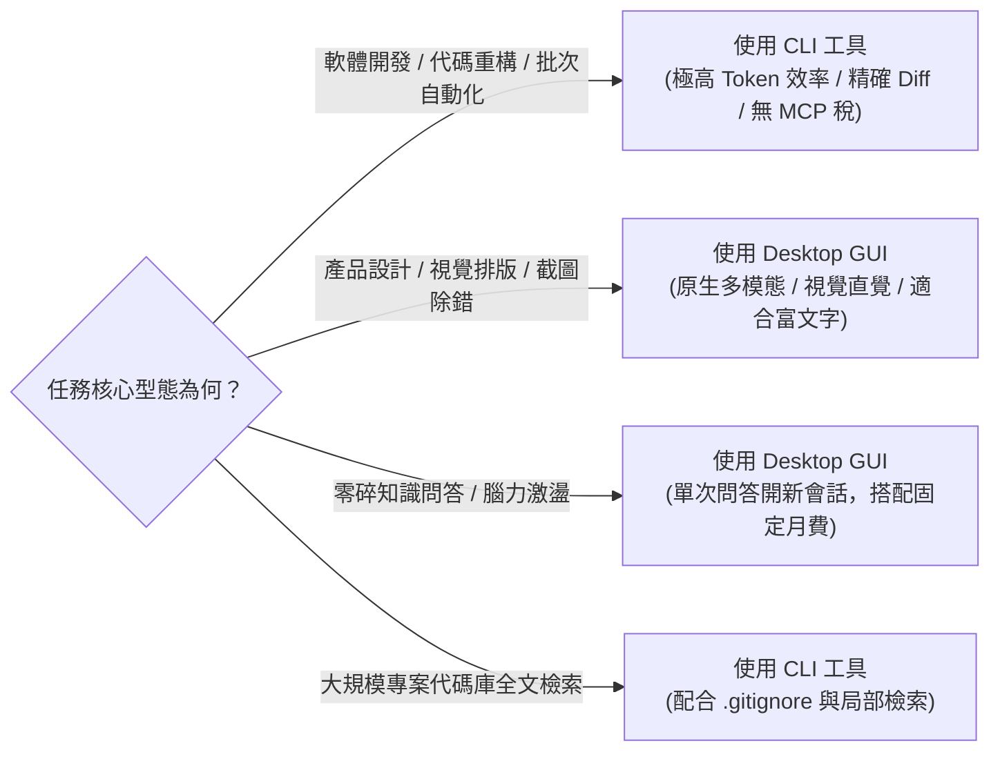

# AI Token 用量比較：Desktop 與 CLI 深度分析

**一句話重點**：Desktop 與 CLI 共用訂閱額度，差在每輪送出的上下文

在大型語言模型（LLM）與 AI Agent 工具普及的背景下，開發者與知識工作者常面臨一個核心矛盾：**「為什麼在桌面客戶端（Desktop GUI）與命令列終端（CLI / TUI）中提出相同或類似的問題，Token 的消耗速率卻有著數倍甚至數十倍的落差？」**

本文件針對 **Desktop（如 Claude Desktop、Cursor、ChatGPT 桌面版）** 與 **CLI（如 Claude Code、Aider、Antigravity CLI、自訂 Shell Agent）** 兩大互動形態，從底層架構、協議開銷、資料過濾機制及計費模型展開深入剖析，並提供具體的優化實踐指引。

---

## 1. 登入方式與額度歸屬：Desktop 與 CLI 吃的是同一份訂閱

談 Token 消耗速率之前，要先釐清「用掉的是哪一份額度」。以 [[Claude（Anthropic）|Claude]] 為例，Desktop 與 CLI 並不是兩套帳務，而是同一個 Anthropic 帳號、同一份訂閱，差別在「使用方式」。

### 1.1 兩種登入與使用方式

| 項目 | Desktop App（Code 分頁） | 終端機 CLI（`claude` 指令） |
| :--- | :--- | :--- |
| **登入方式** | 開啟 App 後以 Anthropic 帳號登入 | 首次執行 `claude` 時選「Claude account with subscription」 |
| **最低方案** | Pro（每月 20 美元）才開放 Code 分頁 | 同左，免費帳號無法使用 Claude Code |
| **核心引擎** | Claude Code，包在圖形介面中 | Claude Code，直接在本機環境執行 |
| **能力差異** | 不支援過程中需回答問題的互動式指令；需終端機的工作要自行切換視窗 | 可直接處理互動式指令、啟動程式、跑腳本 |
| **適合用途** | 簡單任務、初次體驗 | 專案開發、檔案操作、進階自動化 |
| **並存** | 兩者可同時安裝，互不衝突 | ← |

### 1.2 額度池：看「怎麼用」，不看「從哪登入」

Anthropic 自 2026-06-15 起把訂閱用量切成兩個獨立額度池，互不佔用：

| 額度池 | 涵蓋範圍 | 額度與重置 | 用盡後 |
| :--- | :--- | :--- | :--- |
| **互動式使用** | Claude.ai 對話（網頁、桌面、手機）、互動式 Claude Code、Claude Cowork | 訊息用量每 5 小時重置；Pro 為免費版 5 倍，Max 為 Pro 的 5 倍或 20 倍 | 等待重置 |
| **程式化使用** | Agent SDK、`claude -p` 指令、Claude Code GitHub Actions、基於 Agent SDK 的第三方工具 | 每月專屬額度：Pro 20 美元、Max 5x 100 美元、Max 20x 200 美元、Team 標準座位 20 美元／高階座位 100 美元、Enterprise 最高 200 美元 | 已啟用「額外用量」→ 以完整 API 費率計費；未啟用 → 暫停至下個計費週期 |
| **API 金鑰（Claude Console）** | 以 API Key 而非訂閱帳號登入 | 不受上述規則影響 | 按量計費 |

> [!NOTE]
> **推論說明**：來源只寫「互動式 Claude Code」，未逐字點名 Desktop 的 Code 分頁。依定義推論：同一訂閱帳號在 Desktop Code 分頁與在終端機互動使用 Claude Code，都屬互動式使用，**共用同一份 5 小時額度**，兩邊同時開工會一起消耗。只有把 CLI 用在非互動場景（`claude -p`、排程腳本、CI）才改計入程式化月額度。

**快速判斷：**

| 你的使用方式 | 計入哪裡 |
| :--- | :--- |
| Desktop 聊天、Desktop Code 分頁、終端機 `claude` 互動對話 | 互動式 5 小時額度 |
| `claude -p`、排程腳本、GitHub Actions、第三方 Agent SDK 工具 | 程式化每月額度 |
| 以 API Key 登入的 CLI 或自建程式 | API 按量帳單 |

### 1.3 推理都在雲端，差異只在「送了什麼上去」

- 不論網頁、手機或桌面 App，模型推理百分之百在 Anthropic 雲端完成；本地端只負責加密傳輸、介面渲染與暫存。
- 桌面 App 維持登入狀態，與網頁端共享同一個伺服器 Session，可在電腦發問、手機查看進度。
- Claude Code CLI 雖在本機執行指令，「思考」時仍把程式碼片段加密送到雲端分析，再把指令傳回本機執行。

因此 Desktop 與 CLI 的 Token 計算機制相同；用量落差完全來自每一輪送出的上下文組成——系統提示詞、工具定義、檔案內容、對話歷史，這正是下一節要拆解的部分。

> [!NOTE]
> 〈Claude 操作模式與功能介紹〉以 Claude 3.5 Sonnet、Claude 3 Opus／Haiku 為例，模型名稱已過時；但其中「雲端推理、本地只負責傳輸與顯示」的架構描述仍適用。

---

## 2. 核心底層架構四維度剖析

```mermaid
flowchart TD
    subgraph Desktop["桌面版 GUI 模式 (Desktop)"]
        D1["用戶輸入 (Prompt)"]
        D2["UI 狀態與視窗渲染指令 (~5k-10k)"]
        D3["多個 MCP 工具全量 JSON Schema (~20k-50k)"]
        D4["未過濾的檔案整份貼入 / 截圖 (Vision Tokens)"]
        D5["長會話累積未清除歷史"]
        D1 --> D2 --> D3 --> D4 --> D5
        D5 -->|巨大 Context 請求| LLM1["雲端大模型"]
    end

    subgraph CLI["命令列模式 (CLI / Terminal)"]
        C1["用戶指令 (Prompt)"]
        C2["精簡 System Prompt (~500)"]
        C3["Native Shell 指令 / 延遲工具載入 (~0-2k)"]
        C4["Unix 管線預先過濾 (grep / jq / head)"]
        C5["任務導向短會話 / 頻繁 /clear"]
        C1 --> C2 --> C3 --> C4 --> C5
        C5 -->|精簡 Context 請求| LLM2["雲端大模型"]
    end
```



### 維度一：初始載入開銷（System Preamble & Framework Overhead）

任何與 LLM 的對話，底層本質都是無狀態（Stateless）的 HTTP 請求，每一次發送必須附帶「系統提示詞（System Prompt）」。
* **Desktop 桌面端**：
  * 為了維持圖形介面的渲染一致性、 Markdown 樣式、多窗格同步以及行為防呆，桌面應用通常會預先注入龐大的包裝提示詞（Wrapper Framework）。
  * 某些桌面端還會將當前 UI 的選取狀態、焦點檔案路徑及環境元數據預先打包，使得空對話時的前置開銷往往高達 2,000 至 8,000 Tokens。
* **CLI 終端**：
  * 命令列設計遵循「簡約哲學」，底層系統提示詞通常聚焦於核心工程指引（如：如何執行 Shell、輸出 Diff 格式），其基底前置開銷多控制在 500 至 2,000 Tokens 以內。

---

### 維度二：工具協議負擔——「MCP 稅」（Model Context Protocol Tax）

這是近年 Desktop 與 CLI 最顯著的 Token 消耗分水嶺。

> [!WARNING]
> **什麼是「MCP 稅 (MCP Tax)」？**
> 當應用程式掛載 MCP（Model Context Protocol）伺服器時，為了讓 LLM 具備自主調用外部工具的能力，客戶端必須在每一輪 API 請求中，將所有啟用工具的 **完整 JSON Schema（包含工具名稱、功能詳細描述、每個參數名稱與資料型別）** 全部注入 Context Window 中。

* **Desktop 的 MCP 沉重負擔**：
  * 在 Claude Desktop 等圖形客戶端中，使用者傾向常駐掛載多個 MCP 伺服器（例如：GitHub、Google Drive、Postgres、Obsidian、Web Search 等）。
  * 社群實測與分析顯示：**僅掛載 3 至 5 個常見的 MCP 伺服器，使用者尚未鍵入任何文字，就已經消耗了 20,000 至 50,000+ Tokens 的輸入額度**。
  * 每進行一次對話輪次，這幾萬個 Tokens 就必須被反覆重新傳送與計算。
* **CLI 的極致精簡與替代機制**：
  * **Native Shell 優先原則**：CLI 工具可以直接呼叫本機已安裝的系統指令（如 `git log`、`gh pr view`、`aws s3 ls`），LLM 在預訓練階段即具備完整的終端語法知識，**完全無需額外的 Tool Schema 解釋**，工具定義成本近乎為零。
  * **延遲載入（Deferred Tool Definitions）**：現代高效 CLI（如更新版 Claude Code）支援動態工具清單，平時僅聲明工具名稱，直到模型明確發起呼叫意圖時才補傳詳細 Schema，大幅規避了常駐型的 MCP 稅。

---

### 維度三：數據過濾與管道傳輸（Data Ingestion & Unix Piping）

* **Desktop 的「全量餵食」與「視覺代價」**：
  * 圖形介面的操作習慣是直接拖曳檔案、上傳整個 PDF，或複製整個網頁原始碼。
  * **多模態截圖代價**：桌面端支援快速貼圖，但一張高解析度螢幕截圖轉換為視覺 Tokens（Vision Tokens）往往高達 1,000 至 3,000 Tokens，遠高於數十行乾淨的純文字。
* **CLI 的「源頭過濾（Source Filtering）」**：
  * CLI 工具能深度整合 Unix 哲學，在數據進入 LLM 之前先進行預處理與降維：
    ```bash
    # 錯誤做法（整包 10 萬行 log 塞給 LLM）
    cat server.log
    
    # CLI 結合管線過濾（精準提取 5 行關鍵錯誤，節省 99% Token）
    grep -i "error" server.log | tail -n 5
    ```
  * 透過 `jq` 篩選 JSON 關鍵節點、透過 `git diff -U3` 只送出變更程式碼前後 3 行，使每次發送的數據密度達到最高。

---

### 維度四：會話記憶累積與歷史重傳（Context Creep）

* **Desktop 的單一長會話陷阱**：
  * 使用者在桌面端容易養成「一個視窗聊到底」的習慣。隨著會話進行，過去產生的程式碼、重構草案、錯誤重試歷史均被完好保留。
  * 到了第 30 輪對話時，一次簡單的「謝謝」或「請幫我加註解」，背後重傳的歷史長度可能已突破 100,000 Tokens。
* **CLI 的任務導向型生命週期**：
  * CLI 工程師的工作流多為「修復單一 Bug」或「完成單一腳本」，任務完成後立即執行 `/clear` 重置上下文，或仰賴輕量化壓縮機制（`/compact`），使 Context 維持在高度緊湊的健康區間。

---

## 3. 計費模式與心理衝擊比較

> [!NOTE] 已更正（2026-11-24 結案）
> 本節原將 CLI 歸為「API 計費為主」；但依 [[raw/2026-06-15T153635+0800-Claude 2026最新訂閱方案｜Claude ai免費版功能有什麼？Agent SDK費用怎麼算？.md|Claude 2026 訂閱方案]] 與 [[raw/2026-06-15T160222+0800-Claude Code安裝教學｜Desktop App、終端機2種方式怎麼裝？不懂程式也能秒上手.md|Claude Code 安裝教學]]，以訂閱帳號登入的 Claude Code CLI，互動使用與 Desktop 共用同一份訂閱額度，只有 API Key 登入才按量計費、`claude -p` 等程式化使用才另計月額度（見第 1.2 節）。下表「CLI」欄僅適用於 API Key 登入情境。

| 項目 | Desktop 桌面應用（訂閱制為主） | CLI 終端工具（API 計費為主） |
| :--- | :--- | :--- |
| **主要計費形態** | 固定月費訂閱（如 Pro／Team，每月 $20 美元） | 按量計費（Pay-as-you-go，依 Token 百萬計費） |
| **超限與衝擊** | **頻繁觸發用量上限（Rate Limits / Usage Caps）**<br>明明只發了幾句話，卻因為背後隱藏的 MCP 稅與歷史過大，提前耗盡 5 小時額度。 | **直接反映於 API 帳單金額**<br>若遇到自主探索型 Agent 盲目讀取專案幾十個檔案，幾分鐘內可能產生數美元甚至數十美元費用。 |
| **提示詞快取效益<br>(Prompt Caching)** | 各家桌面客戶端對快取命中（Cache Hit）通常未向使用者透明揭露，且視窗閒置容易超過 5 分鐘快取生命週期。 | 透過 API Header 能精準觀測 Cache Write 與 Cache Read，短時間高頻重構時可享有高達 90% 的快取折扣。 |

---

## 4. Desktop vs CLI 完整規格與效益橫向對比表

| 特性與維度                | Desktop (GUI) 桌面介面                      | CLI (TUI) 終端介面                  |    效益領先方    |
| :------------------- | :-------------------------------------- | :------------------------------ | :---------: |
| **初始啟動 Base Tokens** | 2,000 ~ 10,000+ Tokens                  | 200 ~ 1,500 Tokens              |   **CLI**   |
| **MCP 工具常駐開銷**       | 15,000 ~ 50,000+ Tokens（每多一個 Server 加劇） | 接近 0（原生 Shell 優先／延遲載入）          |   **CLI**   |
| **資料預先過濾能力**         | 差（需人工手動修剪複製文字）                          | 極佳（可串接 `grep`、`jq`、`awk` 等終端工具） |   **CLI**   |
| **程式碼修改精確度**         | 容易引導模型重寫整份檔案                            | 原生支援 Unified Diff / 區間補丁編輯      |   **CLI**   |
| **視覺／截圖支援**          | 極佳（直接貼圖、拖曳圖片）                           | 差（需轉為本機路徑或仰賴純文字日誌）              | **Desktop** |
| **長會話控制難易度**         | 困難（使用者易漫談累積膨脹）                          | 容易（提供 `/clear`、`/compact` 快捷重置） |   **CLI**   |
| **學習與操作門檻**          | 極低（滑鼠直覺點擊、開箱即用）                         | 中至高（需熟悉終端指令與快捷鍵）                | **Desktop** |

---

## 5. Token 節流實戰調優指引 (Optimization Playbook)

### 針對 CLI 使用者的最佳實踐
1. **控制命令輸出長度**：避免在對話中直接執行 `npm test`、`mvn build` 或 `git log` 等會噴出幾千行日誌的命令；改用 `git log -n 5` 或 `npm test 2>&1 | tail -n 20`。
2. **務必配置完備的排除清單**：在專案根目錄確認 `.gitignore` 與 AI 專屬忽略檔，嚴格排除 `node_modules/`、`dist/`、`.git/` 以及本機快取目錄，防止 Agent 自主搜尋時將龐大相依套件全數載入 Context。
3. **任務切換立刻 `/clear`**：每個功能寫完或 Bug 修復後，輸入 `/clear` 清空對話歷史，不要攜帶上一階段的上下文進行新任務。
4. **指定行號與精確路徑**：提問時明確指出檔案與區間（例如：`請看 src/index.js 的第 20 至 35 行`），杜絕 Agent 自行翻遍整個代碼庫。

### 針對 Desktop 使用者的最佳實踐
1. **審查並精簡 MCP 配置**：定期檢查 `claude_desktop_config.json`，停用目前沒在使用的 MCP 伺服器，切勿為了省事將幾十個工具一次性永久開啟。
2. **高頻度開新對話（New Chat）**：切勿在同一個對話中切換主題，當一個問題得到結論後，立即開新對話以重置累積的歷史 Context。
3. **分段提供長文件**：面對上百頁的 PDF 或規格書，利用工具提取核心章節後再貼上，不要直接整份丟入對話視窗。
4. **慎用高解析度貼圖**：若能複製終端錯誤文字或日誌，就不要用螢幕截圖貼入，避免浪費高昂的 Vision Tokens。

---

## 6. 決策矩陣：何時該用 Desktop？何時該用 CLI？



* **選擇 CLI 的黃金場景**：專案開發、Bug 排查、Git 版本控制、資料庫批次處理、自動化腳本撰寫。此時 Token 效率即代表著執行速度與真金白銀的開發成本。
* **選擇 Desktop 的黃金場景**：UI／UX 審查、前端視覺校對、包含複雜圖表的報告分析、非技術性文字腦力激盪、初學者探索。此時使用者體驗與視覺直覺高於純粹的 Token 節約考量。

---

## 我可以怎麼用

| 情境 | 做法 |
| :--- | :--- |
| 同時開 Desktop 與終端機 Claude Code | 兩邊共用同一份 5 小時互動額度，額度吃緊時只留一邊在跑長任務 |
| 想讓排程或腳本自動呼叫 Claude（如 `claude -p`） | 這類用量計入程式化月額度，不會擠掉白天互動對話的額度；先確認帳號設定是否啟用「額外用量」，避免超額後以 API 費率計費 |
| ERP 程式開發、查 zpq、改 Big5 檔案 | 用終端機 CLI：可串接 `grep`／`head` 等先過濾輸出，也能處理互動式指令 |
| 看截圖、校對畫面、快速問答 | 用 Desktop，問完一題就開新對話 |
| 公司要以 API Key 讓工具共用 | 改走 API 按量計費，與個人訂閱額度無關，需另外估算帳單 |

---

## 相關參考頁面
- [[Claude（Anthropic）]]：Claude 產品線、方案與 Claude Code 實體頁。
- [[Claude 系統優化與 Token 節省指南]]：詳細記錄了官方 4 條節流指引、PDF 縮減 22 倍技巧與 `CLAUDE.md` 優化規範。
- [[AI CLI 工具比較與選擇_摘要]]：橫向對比各家 CLI 終端工具特性。
- [[LLM 到 Agent 的工程解析]]：深入探討 MCP 協議標準與 Agent 工具呼叫機制。
- [[生成式 AI 企業應用與成本經濟學]]：解析企業落地時的 Token 經濟學與 KV Cache 快取機制。
