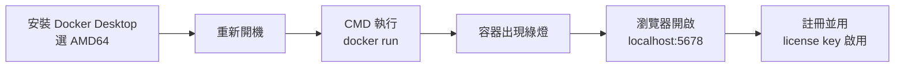
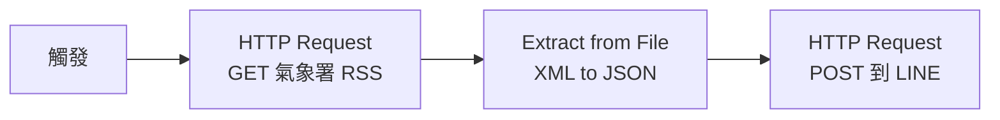
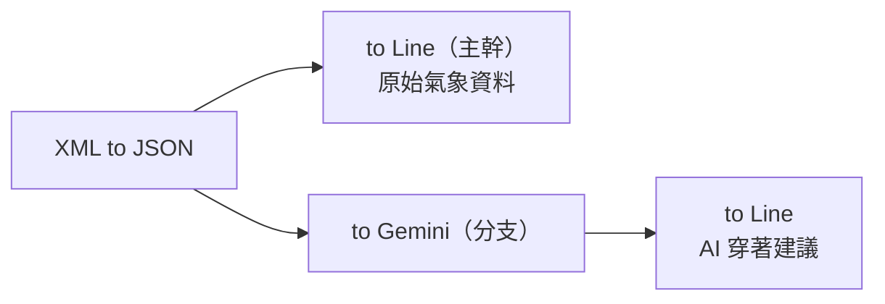

# AI 工作流程自動化實作：n8n 課程總結

本頁整理經濟部產業發展署「AIUP 產發署人培專區」的線上課程〈AI 工作流程自動化實作〉（講師：李迦恩，全長 3 小時 13 分，共三章）。課程從零開始，在本機用 Docker 架設 [[n8n]]，再做出兩個實作：「氣象資料自動推播到 LINE」，以及「交給 Gemini 產生穿著建議後再推播」。

> [!IMPORTANT]
> **核心結論**：n8n 的設計心法是「**一個節點只做一件小事，節點由左到右串成工作流**」。遇到沒有現成節點的服務，就用通用的 **HTTP Request** 節點串 API。每加一個節點都要回畫布執行整個流程，**每個節點都出現綠色勾勾**才算成功。

> [!NOTE]
> 課程沒有提供講義，原始整理稿是依 Vimeo 自動字幕寫成。簡報上的 API 網址、JSON 範本等，講師沒有念出來的部分已依官方文件補上，原始檔中標為「（補充）」。
> 課程頁：https://eii.nat.gov.tw/aimfg/course/e3eb0d6dcb2946ec88997f7f89bd57cf/detail

---

## 一、課程架構

| 章節 | 主題 | 長度 | 產出 |
| :--- | :--- | :---: | :--- |
| 第一章 | n8n 介紹、安裝及註冊 | 01:07:54 | 本機 Docker 環境＋可登入的 n8n（`localhost:5678`） |
| 第二章 | 無程式碼串接：專屬天氣推播小幫手 | 01:01:39 | 4 節點工作流：RSS → JSON → LINE |
| 第三章 | 結合 AI 工具（Gemini） | 01:03:53 | 加入 Gemini 分支，用 AI 產生穿著建議並推播 |

---

## 二、第一章：環境建置

### 1. n8n 與 Docker 的關係
- **雲端版**：由 n8n 官方代管，需要付費（錄影當時約 20 歐、50 歐的方案）。
- **本地版**：免費，但要自己準備環境，所以需要 **Docker**。
- **Docker 就像軟體界的標準貨櫃**：把程式碼、執行環境、函式庫和設定檔打包成一個容器（Container），放到哪台機器都能用同樣的方式執行，解決「我的電腦能跑，換台機器就跑不動」的問題。
- **Image 就像漢堡**：由多層功能堆疊而成。

### 2. 安裝與啟動流程

- 指令：`docker run -d -p 5678:5678 -v <本機路徑>:/home/node/.n8n docker.n8n.io/n8nio/n8n`
  - `-d`：在背景執行
  - `-p`：連接埠對應
  - `-v`：資料保存的位置
- 出現 `docker-desktop is unable to start` 時，先執行 `wsl --update`，再重新執行 `docker run`。
- **重新使用的流程**：開啟 Docker Desktop → Containers → 按 ▶ 讓圓點變綠色 → **等大約 5 秒暖機** → 開啟 `localhost:5678`。
- 要停用時按 **Stop**；**不要按垃圾桶**，按了會刪掉容器。

### 3. 介面重點
- **右側「＋」**：新增節點，最常用。
- **左側「＋」**：新增 Workflow 或 Credential。
- 首頁有三個分頁：**Workflows**（工作流清單）、**Credentials**（外部服務的驗證）、**Executions**（執行紀錄，顯示成功或失敗）。

---

## 三、第二章：天氣推播小幫手

| 節點 | 關鍵設定 |
| :--- | :--- |
| HTTP Request（抓資料） | Method 用 `GET`；URL 填中央氣象署的縣市 RSS 網址（`.xml`），課程以高雄市為例 |
| Extract from File | Mode 選 `XML to JSON`；開啟 Normalize Tags（標籤轉小寫）和 Trim（去掉多餘的空白與換行） |
| HTTP Request（送 LINE） | Method 用 `POST`；URL 填 `https://api.line.me/v2/bot/message/broadcast`；Header 加 `Authorization: Bearer <token>` 和 `Content-Type: application/json`；Body 用 JSON Expression，把欄位拖拉進訊息 |

**觀念整理**
- **RSS**：以 XML 為基礎的標準格式，讓程式能自動抓到網站最新的內容。
- **JSON**：輕量的鍵值對（key-value）格式。和 XML 比，檔案較小、傳輸較快，屬於半結構化資料。
- **GET 與 POST**：拿東西（查詢、下載）用 GET；送東西（發送、廣播、上傳）用 POST。
- **LINE Notify 已停止服務**：要改用 LINE Official Account 的 **Messaging API**。到 LINE Developers Console 建立 Provider，再建立 Messaging API channel，最後按 **Issue** 產生 Channel access token。

---

## 四、第三章：Gemini AI 分支

- **操作技巧**：
  - **Duplicate** 工作流，改副本，避免把原本的流程改壞。
  - 拖曳節點右邊的小白點來**拉出分支**。
  - **複製節點**與 **Rename** 節點，例如命名為 `HTTP Request (to Gemini)`，幫助日後記得用途。
- **Gemini 串接**：
  1. 到 Google AI Studio 建立 Project 和 API key。
  2. 在 n8n 建立 **Header Auth** credential，把 API key 存進去。
  3. to Gemini 節點設定 `POST`，填 Gemini 2.5 的 API 網址，驗證方式選 Generic Credential Type → Header Auth。
- **提示詞設計**：
  - 「你是一位氣象主播，不用問安。先告訴我今日真實的天氣狀況，再用不超過 40 字建議穿著與注意事項，內容要適合在 LINE 推播。」
  - 設計重點：**指定角色、去掉客套、先複述原始資料、限制字數、指定用途**。
- **驗證機制**：主幹傳原始氣象資料，分支傳 AI 建議，兩則訊息互相對照，確認 AI 沒有亂講。等到完全信任後，可以拿掉這個檢查。
- **擴充方向**：用 IF、Switch 做條件判斷；把觸發節點改成定時執行；也可以串 Google Drive、Sheets、Gmail 等服務。
- 講師的提醒：**資料是 AI 的底氣**。只啟動容器不需要網路，但串接外部 API 時網路必須暢通。

---

## 五、與本庫其他知識的關聯

- **同類工具**：[[Dify]] 也提供視覺化 Canvas 工作流，但偏重 LLM 應用與 RAG；n8n 偏重**跨系統的流程自動化與 API 串接**。
- **Google 生態**：Gemini API key 的申請可參考 [[AI 工具與框架概覽#9. Google AI Studio 進階開發實務]]；Gemini 的整體用法見 [[Gemini 全能使用手冊與 Google 生態工作流]]。
- **用 Agent 取代 n8n 的討論**：見 [[Antigravity 核心概念與五層記憶系統]] 引用的「N8N 要被取代了？」影片（SRC-133）。
- **在 ERP 情境的應用構想**（整理者補充）：排程觸發 → 查詢資料 → AI 摘要 → 推播通知，適合用在每日異常報表、待辦提醒、交期或庫存警示。n8n 用 Docker 自架，資料可以留在內網；但送資料到外部 AI 之前，要先確認資料機密規範。
