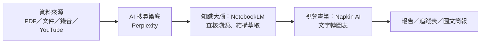

# NotebookLM 與 Napkin AI 知識管理課程

臺南市政府「e 學補給站」線上課程〈搞懂 NotebookLM 與 Napkin AI：提升你的知識管理力〉的重點筆記，講師為巨匠電腦蘇世榮，共六個單元約 172 分鐘。課程以 ESG、公務會議為範例，示範從蒐集資料、萃取知識到視覺呈現的完整流程。功能規格以課程當時為準。

**一句話重點**：NotebookLM 整理知識，Napkin 把文字變圖

## 一、雙工具流程

- **NotebookLM**：只以使用者提供的資料為依據（Grounding），每個回答附引用標號，點下去會跳到原文對應段落，降低幻覺。
- **Napkin AI**：把 NotebookLM 萃取出的條列重點，一鍵轉成流程圖、心智圖、矩陣等資訊圖表。

## 二、NotebookLM 介面與來源限制（單元一）

| 版面 | 功能 |
|------|------|
| 左：來源面板 | 管理、勾選要用的來源（全部或部分） |
| 中：對話區 | 提問，回答附可點擊的引用 |
| 右：工作室／記事 | 語音摘要、FAQ、學習指南、時間軸、簡報大綱；對話結果可存成筆記再當素材 |

| 項目 | 限制 |
|------|------|
| 每本筆記 | 最多 50 個來源 |
| 單一來源 | 最大 200 MB、約 50 萬字 |
| 支援格式 | Google 文件與簡報、PDF、TXT、Markdown、MP3 等音訊（自動轉文字） |
| 網頁 | 只抓公開頁面的文字；需登入或付費牆不行；圖片中的文字、嵌入影片讀不到 |
| YouTube | **必須有字幕軌**；私人影片不行；剛發布 72 小時內可能還沒索引好 |

沒有基礎資料時，先用 Perplexity 廣泛搜尋（例：「幫我找出 ESG 的相關資料，包含網頁、文件檔、影片」），再把法規、研究報告、影片網址批次匯入。

## 三、會議錄音四步整理（單元二）

1. **摘要**：「幫我完成會議記錄重點摘要，500 字。」
2. **三段式結構**：背景議題（核心主軸）→ 重點觀察（關鍵數據、爭議、決策）→ 行動建議（要做什麼、責任人、時限）。
3. **任務清單**：列出所有任務的 What／Who／When，待確認的資訊要註記。
4. **追蹤 Email**：依「三段式摘要 → 任務清單 → Email 草稿（專業精簡、條列、結尾列下一個檢視節點）」輸出。

## 四、來源可靠度 ABCD 評分法

| 等級 | 可靠度 | 時間 | 內容類型 | 來源 |
|:---:|:---:|:---:|---|---|
| A | 高度可靠 | 6 個月內 | 具體數據、法規明文 | 官方機構、主要研究機構、業界權威報告 |
| B | 可靠 | 6～18 個月 | 數據或高階見解 | 知名媒體、有實績的專家 |
| C | 一般 | 18～36 個月 | 見解與觀點為主 | 個人部落格、二手整理 |
| D | 低 | 3 年以上 | 主觀、情緒化 | 來源不明、無數據佐證 |

判斷順序：**先看時間，再看類型，最後看來源**。

## 五、工作室功能與自訂架構（單元三）

- **語音摘要**（雙主持 Podcast）：用「自訂」輸入導引，例如「辯論重點在於如何了解 ESG 報告框架與標準指南，語氣專業，要讓一般民眾聽得懂」，避免流於寒暄。
- **研習工具**：FAQ（預測 5～10 個常見問題）、學習指南（綱要、短答題、申論題）、時間軸（法規修訂、專案進度）。
- **自訂架構**：主動指定分析維度（例如 ESG 報告依 E、S、G、執行流程與指標、績效衡量與揭露、法規趨勢六塊），要求 AI 依骨幹重整所有來源。

## 六、簡報四守則與提示詞模板（單元四）

1. **一頁一個概念**。
2. **保留約 25% 留白**。
3. **資訊層級分明**：主要數據放大，次要說明用色塊或引導線區隔。
4. **數據與觀點視覺化**：對比、流程、比例改成圖形，不要純文字條列。

提示詞模板分三段：【基本資訊】主題、內容大綱、目標對象 → 【設計風格】留白、層級、可讀性、色塊區隔 → 【輸出要求】每頁一概念、數據視覺化。

## 七、表格萃取與品牌角色（單元五）

- **問卷表格化**：只要指定欄位（例：想學技能、希望得到的幫助、需求人數、急迫性）。
- **風險燈號追蹤表**八欄：日期、議題分類、燈號（綠＝順利、黃＝需觀察、紅＝嚴重卡關）、關鍵決策、風險與卡點、關鍵數據（百分比、金額、數量）、下一步與期限（事項 by MM/DD）、負責人。
- **品牌吉祥物資訊圖**：上傳代言角色圖，要求顏色與原圖一致、自然出現在 5～7 個觀點旁，且動作要和觀點有關（指著重點、抱書、驚訝提醒），不是單純裝飾；內容只能根據已上傳的資料，不憑空捏造。

## 八、Napkin AI 五步驟（單元六）

網址：`https://app.napkin.ai/`

1. **貼入結構化文字**（例如 NotebookLM 產出的條列大綱）。
2. **點段落旁的 Spark 閃電按鈕**，系統分析文意並給多個圖表預覽。
3. **依關係選圖型**：順序 → 流程圖、階段圖；並列 → 格狀矩陣、放射圖、心智圖；循環 → 循環圖；對比 → 雙欄對照。
4. **編修**：換向量圖示、一鍵換配色主題。
5. **匯出**：PNG（可透明背景）、SVG（可無損放大、二次編輯）、PDF，或直接複製貼到 PowerPoint、Word。

## 九、六階段 SOP 檢核表

| 階段 | 工作 | 工具 | 檢核重點 |
|------|------|------|----------|
| 資料築底 | 蒐集法規、錄音、研報、影片 | Perplexity／網路 | PDF ≤ 200 MB、YouTube 有字幕 |
| 知識彙整 | 建筆記本匯入來源 | NotebookLM | 來源數 ≤ 50、確認解析完成 |
| 來源審查 | 評可靠度 | NotebookLM | 套用 ABCD |
| 結構提煉 | 會議紀錄、三段式、任務清單 | NotebookLM | What／Who／When、500 字摘要 |
| 視覺轉換 | 文字轉圖 | Napkin | 選最符合語意的圖型 |
| 編修匯出 | 配色、圖示、匯出 | Napkin | 透明 PNG 或 SVG 貼入簡報 |

## 我可以怎麼用

- **ERP 需求訪談與會議**：會議錄音丟進 NotebookLM，照四步產出摘要、三段式、What／Who／When 任務清單與追蹤信；任務清單可直接對應需求單的待辦。
- **ABCD 評分用在 Wiki 入庫**：入庫時先替素材評級（時間、類型、來源），在頁面註明，例如官方公告是 A、業者口述是 B 或 C；遇到新舊衝突時，評級可以當判斷參考（但仍由使用者決定）。
- **專案風險燈號表**：ERP 上線專案的週報可套用八欄風險燈號表，請 AI 從會議紀錄自動整理。
- **ERP 流程圖**：把簽核流程、批次步驟的條列文字貼進 Napkin，快速產出流程圖放進規格書或教育訓練簡報；需要可編輯的版本就匯出 SVG。
- **簡報四守則**：和 [[HTML 簡報：AI Agent 時代的教學簡報完全體]] 搭配，「一頁一概念、留白 25%」可寫進簡報 Skill 的規則。

## 關聯頁面
- [[NotebookLM 進階應用與實戰指引]]（會議紀錄、財報分析等實戰場景）
- [[NotebookLM 綜合指南]]
- [[HTML 簡報：AI Agent 時代的教學簡報完全體]]
- [[個人知識管理系統構築]]
- [[Gemini 全能使用手冊與 Google 生態工作流]]
