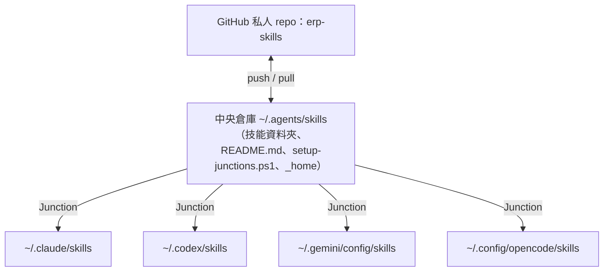

# 跨 Agent 技能共用：中央倉庫與 NTFS Junction

使用者為 Claude Code、Codex、Antigravity、OpenCode 四套工具（CLI 與 IDE）共用同一套自訂技能所做的架構規劃與實施紀錄（規劃書最後更新 2026-10-06），以及檢視目錄連接點的操作說明。技能清單以中央倉庫的 `README.md` 為準，本頁不列完整清單。

**一句話重點**：技能只存一份，四工具用 Junction 共用，跨機靠 Git

## 一、要解決的問題（建倉前的現況）

| 問題 | 說明 |
|------|------|
| 檔案散落、版本不一 | `.gemini`、`.claude` 各有一份實體副本，`.codex` 只有部分技能，OpenCode 沒有；改一處其他不會連動 |
| 各工具路徑封閉 | Claude Code 只讀 `~/.claude/skills`、Codex 只讀 `~/.codex/skills`、Antigravity 只讀 `~/.gemini/config/skills`，無法用一個設定讓大家都改讀同一處 |
| 連結無法跨電腦 | Symlink／Junction 是本機磁區指標，複製或 Git 都帶不走，換電腦要重建 |
| 雲端硬碟不適合即時讀取 | Google Drive 串流磁碟離線或延遲時，可能讓 CLI 啟動逾時、檔案鎖定 |
| 新機冷啟動與編碼陷阱 | 目錄不存在就執行腳本會報錯；舊實體資料夾可能被誤刪；PowerShell 5.1 讀無 BOM 的 UTF-8 會崩潰 |

## 二、架構：中央倉庫＋NTFS Junction＋私人 Git repo



- **為什麼選 Junction**：不需要開發者模式或系統管理員權限；不多占硬碟；各工具照樣讀自己的預設路徑，底層卻都是同一份檔案，任何一處存檔即全部生效。
- **為什麼中央目錄是 `~/.agents/skills`**：原本就存在且有 `.skill-lock.json`；OpenCode 官方也把它列為相容掃描路徑；將來共用規則可放 `~/.agents/rules`。
- **同步方式定案（途徑三）**：中央倉庫本身就是 Git repo，遠端是私人 repo `erp-skills`（**含公司內部資訊，必須維持 Private**）。
  - **技能不用 chezmoi 管理**：避免同一份技能在 chezmoi 與 Git repo 各存一份，違反單一真相來源；chezmoi 只管 `~/.claude/rules` 等全域設定。
  - **Google Drive 不放任何技能**：2026-10-06 已刪除雲端硬碟上的散落副本；團隊安裝包以 fileserver 上的版本為準。
- **例外**：`sanshiba-voice` 只在家裡 NB，以 `.git/info/exclude` 排除；`finmind-agent` 只放在 `~/.codex/skills` 當 Codex 專用實體資料夾。

## 三、兩支腳本

**`setup-junctions.ps1`**（放在 repo 內，以 repo 版本為準）：
1. 確保四個工具的技能目錄存在。
2. **只有含 `SKILL.md` 的資料夾才算技能**；`_home`、`.` 或 `_` 開頭、名稱含 `backup` 的排除。
3. 已有正確的 Junction 就跳過，可重複執行。
4. 遇到同名**實體資料夾**，先搬到 `~/.agents/skills-backup/<工具>/<技能>-<時間>` 再建 Junction，不直接刪。
5. **不會清除**已從中央倉庫移除的技能所留下的舊 Junction，要手動刪。

**`bootstrap-skills.ps1`**（新機冷啟動入口，放在 vault 的 `AI/scripts/`）：
1. `~/.agents/skills` 還不是 Git repo 就 `git clone`；目錄已存在、非空、又不是 repo 時停止，避免覆蓋。
2. 掃描四個工具目錄中含 `SKILL.md` 的實體資料夾，中央倉庫沒有的才搬進去（同名以 repo 為準；`finmind-agent` 不搬），最後提醒 commit。
3. 複製 `_home\erp_web_client.py` 等檔案到家目錄（已有不同版本時只提醒、不覆蓋）。
4. 執行 repo 內的 `setup-junctions.ps1`（不再內嵌、不再覆寫它）。

沒有 Google Drive 的新電腦：直接 `git clone` → 執行 `setup-junctions.ps1` → 複製 `_home` 檔案，效果相同。CVS 密碼檔（`*.dpapi`）不進 repo，第一次用 `erp-cvs` 時重新設定。

## 四、踩坑與教訓

1. **PowerShell 5.1 編碼**：讀無 BOM 的 UTF-8 腳本時，中文字串會造成 `TerminatorExpectedAtEndOfString`。腳本一律存成 UTF-8 with BOM：
   ```powershell
   [System.IO.File]::WriteAllText($scriptPath, $scriptContent, [System.Text.Encoding]::UTF8)
   ```
   用 PowerShell 的 Parser 檢查語法錯誤數應為 0。
2. **新機冷啟動**：還沒 clone 就執行 `setup-junctions.ps1`，必然出現「`-File` 參數的引數不存在」。
3. **先搬再換**：建立 Junction 前，務必確認既有實體技能已完整進入中央倉庫。
4. **程式碼只留一份**：2026-10-02 曾發現文件內嵌版、冷啟動腳本內嵌版、repo 版三份 `setup-junctions.ps1` 內容都不同；之後文件只說明行為、指向 repo。
5. **PowerShell 與 CMD 的環境變數**：PowerShell 不解析 `%USERPROFILE%`，會當成字面路徑而報「找不到路徑」；要寫 `$HOME`、`~` 或 `$env:USERPROFILE`。要用 CMD 語法就包成 `cmd /c "dir %USERPROFILE%\.claude\skills"`。
6. **驗證分兩層**：Junction 建好只代表目錄通了；要再用 `claude -p` 或 `opencode debug skill` 實測 Agent 真的載入技能。

## 五、檢查與驗證

**檢視連接點的三種方式**：

| 方式 | 指令／操作 | 判讀 |
|------|------------|------|
| PowerShell（推薦） | `Get-ChildItem ~/.claude/skills \| Select-Object Name, LinkType, Target` | `LinkType` 為 `Junction`、`Target` 指向 `~/.agents/skills/...` |
| CMD | `dir %USERPROFILE%\.claude\skills`（PowerShell 中用 `cmd /c` 包起來） | 顯示 `<JUNCTION>` 並在中括號列出目標；一般資料夾是 `<DIR>` |
| 檔案總管 | `Win+R` 輸入工具技能路徑 | 資料夾圖示左下角有捷徑箭頭 |

**穿透讀取測試**：`Get-Content ~/.claude/skills/erp-big5/SKILL.md -Head 10`，能印出 frontmatter 即代表映射正常。

**完整驗證清單**：
1. 檔案系統：四個工具目錄的技能都是 Junction、指向中央倉庫。
2. Antigravity：README 列的每個技能都是 Junction 且有 `SKILL.md`。
3. Claude Code：`"" | claude -p "你有什麼自訂 skills 可以使用？請只簡要列出名稱"`。
4. Codex：除內建 `.system` 外都是 Junction（`finmind-agent` 例外）。
5. OpenCode：`opencode debug skill`；找不到指令表示只裝了桌面版，用 `npm i -g opencode-ai` 補 CLI。

## 我可以怎麼用

- **日常三種操作**：
  - **修改技能**：從任何入口打開都是同一份，存檔即生效；收工時到 `~/.agents/skills` 執行 `git add -A`、`commit`、`push`。
  - **新增技能**：在中央倉庫建資料夾與 `SKILL.md` → 重跑 `setup-junctions.ps1` → 更新 README 技能清單 → commit、push。
  - **刪除技能**：刪資料夾、更新 README、commit、push，**再手動刪各工具目錄殘留的 Junction**。
- **另一台電腦**：`git pull` 即生效；只有新增技能才需要重跑 `setup-junctions.ps1`。改了 `_home\erp_web_client.py` 記得同步到家目錄。
- **收工流程多檢查一個地方**：除了專案 repo 與 chezmoi，還要看 `~/.agents/skills` 有沒有未提交的修改；這個 repo 含公司資訊，確認仍是 Private。
- **單一真相來源用在 ERP 文件**：規格、腳本、設定都只留一份正本，其他地方用連結或「以某處為準」指過去，不要複製內嵌——這次三份腳本內容不一的教訓同樣適用規格書與 SQL。
- **在 PowerShell 下指令**：家目錄寫 `$HOME` 或 `~`，看到 `%...%` 就知道是 CMD 語法（也是 Claude Code 在 PowerShell 執行指令時常見的錯誤）。

## 關聯頁面
- [[AI Agent 實戰與 MCP 伺服器整合]]（chezmoi 管理全域規則）
- [[Google 雲端硬碟串流、鏡像與離線存取設定指南]]（串流 G: 與鏡像路徑差異、禁止對 G: 根目錄遞迴搜尋）
- [[AI Agent 基本功系列實踐指南 (EP01-EP07)]]（跨裝置、跨 Agent 協作觀念）
- [[Claude 與 ChatGPT 雙向搬家：記憶、對話紀錄與 Skills]]（跨平台搬 Skill）
- [[Claude Cowork 與 Agent Skill 實務]]
- [[LLM 到 Agent 的工程解析]]（Agent Skill 結構）
